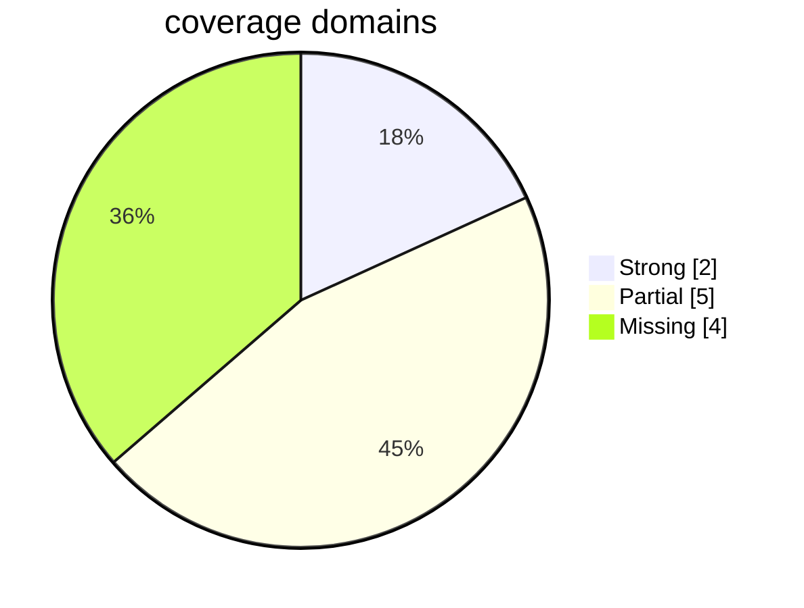
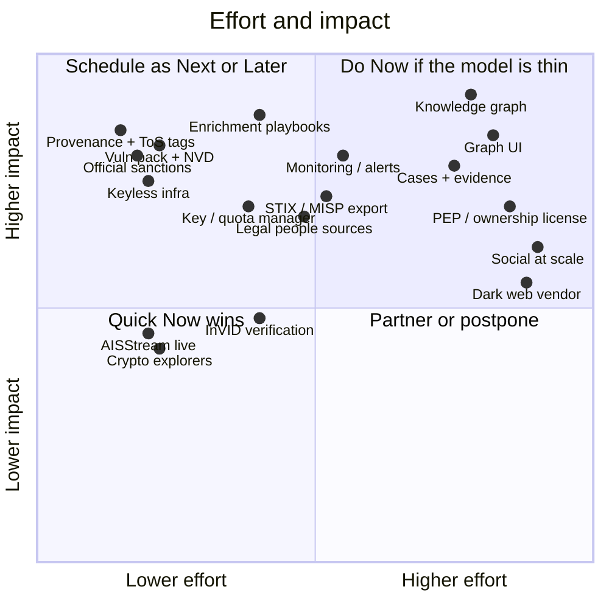

# CoreNews Competitive Gap Analysis

What CoreNews still needs to become a competitive, best-in-class OSINT product, based on current free-tier data access and a review of leading commercial and open-source platforms as of 18 November 2026 (America/Detroit). The application code and UI have not been reviewed.

**Sources recorded on this page**

- Maltego product, pricing, Graph, and Maltego One pages, reviewed 18 November 2026
- Recorded Future Intelligence Graph, platform, AI, and API pages
- Intel 471 Cyber Threat Exposure; SpiderFoot GitHub README
- ShadowDragon SocialNet and Horizon Monitor product pages
- Babel Street platform, Insights, and OSINT Streams pages
- Dataminr First Alert and Pulse product pages
- Flashpoint Echosec product page; Silobreaker product page
- Censys Platform and Attack Surface Management pages; Shodan products page
- Hunchly homepage and hashing knowledge-base article
- OSINT Industries homepage; Social Links SL Crimewall product page
- OpenCTI data-model and graph docs; MISP features; IntelOwl introduction
- theHarvester GitHub; Recon-ng features wiki
- OpenSanctions commercial-exemption docs; AISStream official documentation
- WeVerify / InVID verification plugin; Meta Content Library access docs
- CoreNews OSINT Source Catalog (18 November 2026) and current .env key inventory

## Contents

- [Executive summary](#summary)
- [Coverage matrix](#coverage)
- [Competitor snapshot](#competitors)
- [Capability gaps to check](#capabilities)
- [Trust, legal, and commercial](#trust)
- [Roadmap](#roadmap)
- [Where a free-source product can win](#differentiation)
- [Prioritized gap table](#gaps)
- [Sources](#sources)

> **Data access only.** This review compares CoreNews's current keys and identified free sources with what leading OSINT and threat-intel products publish on their official pages. The CoreNews application code, UI, and existing pipelines have not been inspected. Product capabilities below are things to check or build, not confirmed absences.

| Value | Label | Detail |
| --- | --- | --- |
| 14 | Services with keys | Plus identified keyless sources |
| 2 | Domains rated strong | Infrastructure and vulnerabilities |
| 5 | Domains rated partial | CTI, corporate, news, geo, transport |
| 4 | Domains rated missing | People/social, dark web, crypto, media forensics |
| 9 | Now items | 15 on the Next horizon |

## Executive summary

*The five gaps that most affect whether CoreNews can compete as a product, not just a collection of APIs.*

1. Build an investigative workbench, not a keychain. Maltego, Social Links, OpenCTI, and Recorded Future win on entity resolution, a knowledge graph, link analysis, and one-click pivots. If CoreNews is still a set of API keys, this is the product gap that matters most — and it has not been verified in the app.
2. People, identity, and social media coverage is missing. Hunter's free plan is 50 credits a month. After platform API restrictions, commercial tools sell this as a core feature. Wikidata, LittleSis, GitHub, OpenAlex, and Bluesky help, but they do not replace a social graph.
3. Monitoring, cases, and evidence are how professional tools are used day to day. Dataminr, ShadowDragon Horizon Monitor, Shodan Monitor, and Censys ASM watch continuously. Hunchly captures pages with SHA-256 hashes and an audit trail. These are capabilities to check or add, not more signups.
4. PEP and commercial-grade entity screening are weak on free tiers. Official OFAC, EU, UN, and UK lists can cover sanctions now. A general PEP or global beneficial-ownership graph is not available for commercial use without a license: OpenSanctions bulk is CC BY-NC, its API is grant-only, and Companies House was skipped.
5. Dark web, credential-leak, and underground intel will stay a paid-vendor gap. The HIBP breach API is paid. Official Tor metadata and Ahmia list exports are the ethical free path. Do not close this with stolen dumps or scrapers; buy a reputable feed if customers need it.

## Coverage matrix

*Ratings are for data access in hand or clearly identified, not for whether the app already uses the data. Wiring and UI remain unchecked.*

Eleven OSINT domains, scored Strong, Partial, or Missing against CoreNews's current keys and the free sources already catalogued. Where free options are structurally weak, that is called out instead of promising a later signup will close the gap.

| Domain | CoreNews coverage | In hand or already identified | Free sources that can fill the gap | Where free options are weak |
| --- | --- | --- | --- | --- |
| Infrastructure / attack surface | Strong | Shodan, Censys, DNSDumpster, IPinfo Lite, MaxMind GeoLite2 | crt.sh, RDAP, RIPEstat/BGPView, Team Cymru, PeeringDB, Wayback CDX, Common Crawl, ICANN CZDS, Spamhaus DROP | Free Shodan and Censys quotas are lookups, not the commercial Censys Platform or Shodan Monitor, Maps, Trends, and Enterprise products. |
| Threat intel / IOCs | Partial | VirusTotal, AlienVault OTX, AbuseIPDB, urlscan.io; GreyNoise Community at low volume | MITRE ATT&CK STIX/TAXII, CIRCL hashlookup, Spamhaus DROP, community sandboxes (Hybrid Analysis, tria.ge) within their terms | abuse.ch Auth-Key was skipped (URLhaus, ThreatFox, MalwareBazaar, Feodo, SSLBL). No criminal-underground collection comparable to Recorded Future, Flashpoint, or Intel 471. Some community APIs require a paid plan for commercial use. |
| Vulnerabilities | Strong | NIST NVD API key | CISA KEV (CC0), EPSS, OSV, CVE List cvelistV5, GitHub Advisory Database, CIRCL Vulnerability-Lookup, Shodan CVEDB | Public feeds are excellent for CVE context. They do not replace vendor exploit intelligence or Intel 471-style 'is this being weaponized now' underground signal. |
| People / identity / social media | Missing | Hunter free plan (50 email-search credits/month) | Wikidata, LittleSis, OpenAlex, GitHub API, Bluesky public AppView — all legal public sources, not a social graph | This is a core paid differentiator for Maltego, Social Links, ShadowDragon SocialNet, OSINT Industries, and Babel Street. Facebook, Instagram, LinkedIn, and X programmatic access is restricted, paid, or limited to approved research programs (Meta Content Library is for qualified academic or nonprofit researchers). Free options cannot close this gap at commercial depth. |
| Corporate / sanctions / PEP | Partial | OpenFEC and Congress.gov via api.data.gov | OFAC SLS, EU Financial Sanctions File, UN Security Council list, UK Sanctions List, GLEIF LEI (CC0), SEC EDGAR, Wikidata, ICIJ Offshore Leaks bulk (check terms) | Official lists cover designations, not a general PEP database. OpenSanctions API is grant-only; bulk data is CC BY-NC and not a commercial-product foundation. UK Companies House was skipped (GOV.UK One Login). OpenCorporates free tier is small and not licensed for commercial product use. |
| News / events / geopolitical | Partial | GDELT DOC API identified as keyless | ReliefWeb, Media Cloud, ACLED (org-type access), Humanitarian Data Exchange, USGS earthquakes | NewsAPI.org developer keys are not allowed in staging or production. CoreNews will not match Dataminr, Babel Street, Flashpoint Echosec, or Silobreaker on real-time, multilingual, multi-modal event detection. |
| Geospatial / imagery | Partial | NASA FIRMS MAP_KEY | Copernicus CDSE / Sentinel Hub, OSM Overpass (ODbL + attribution), Overture Maps, USGS earthquakes | No commercial high-resolution tasking. No social geotag firehose. FIRMS is thermal anomalies, not a general imagery platform. |
| Transport (air / sea) | Partial | OpenSky Network (ADS-B; 4,000 credits/day on the free account) | AISStream free live WebSocket for terrestrial AIS | AISStream official docs: 3 connections, no SLA, no durable replay or history. Open-ocean and historical AIS are generally paid satellite products. Air is in hand; sea is not. |
| Dark web / leaks | Missing | Pwned Passwords range API only; HIBP breach API is paid and was skipped | Official Tor Onionoo and exit lists; Ahmia onion and blocklist exports (no public search API; do not scrape the search UI) | Free official sources are network metadata, not marketplace or breach-index collections. Recorded Future, Flashpoint, and Intel 471 sell underground intel. Do not close this gap with stolen credential dumps or ToS-violating scrapers. |
| Crypto / blockchain | Missing | None signed up yet | Etherscan free API, mempool.space (keyless; self-host for volume) | Public explorers trace transactions. They do not replace clustering, attribution, or cross-chain products used in Maltego crypto workflows or commercial blockchain-intelligence tools. |
| Image / video verification | Missing | None | InVID / WeVerify verification plugin, file metadata, reverse-image search within each engine's terms | Forensic filters suggest possible manipulation; they are not proof. Babel Street Visual Intelligence and Social Links ML image/video analysis are commercial capabilities CoreNews will not match with plugins alone. |

## Competitor snapshot

*Features below are taken from official product or documentation pages reviewed on 18 November 2026 (America/Detroit). Pricing is omitted except where a vendor publishes a figure; most commercial platforms quote privately.*

Commercial tools cluster into investigation workbenches (Maltego, Social Links, ShadowDragon, OSINT Industries), threat-intel platforms (Recorded Future, Flashpoint, Intel 471, Silobreaker), real-time event monitors (Dataminr, Babel Street, Echosec), and internet-visibility platforms (Censys, Shodan). Open-source tools cluster into a graph/sharing stack (OpenCTI, MISP) and an enrichment/recon stack (IntelOwl, SpiderFoot, theHarvester, Recon-ng). Hunchly is the evidence-capture specialist and is bundled into some Maltego plans. Maltego's pricing page lists Professional Standard at €7,500 per year as of its January 2026 capabilities list; other vendors in this set do not publish comparable list prices on the pages reviewed.

| Product | Type | What official pages say they are strongest at |
| --- | --- | --- |
| [Maltego](https://www.maltego.com/) | Commercial | Graph and link analysis, guided Transforms, Maltego Search/Monitor/Evidence, built-in Data Pass, Cases, and Hunchly on some plans. Maltego One is the 2026 browser workspace. |
| [Recorded Future](https://www.recordedfuture.com/platform/intelligence-graph) | Commercial | Intelligence Graph over 1M+ sources (open web, dark web, technical feeds, telemetry). Risk scores, alerts, AI reports, and a broad API. |
| [Intel 471 / SpiderFoot](https://www.intel471.com/platform/cyber-threat-exposure) | Commercial + OSS | Verity471 Attack Surface / Cyber Threat Exposure correlated with underground CTI. SpiderFoot OSS still automates 200+ OSINT modules with recursive pivoting and GEXF export. |
| [ShadowDragon](https://shadowdragon.io/products/socialnet/) | Commercial | SocialNet maps aliases and social networks from public data. Horizon Monitor provides continuous keyword, identity, and topic alerts. |
| [Babel Street](https://www.babelstreet.com/platform) | Commercial | Rights-cleared multilingual data (200+ languages), identity resolution, agentic Insights Investigator, visual intelligence, and always-on OSINT streams. |
| [Dataminr](https://www.dataminr.com/products/first-alert/) | Commercial | Real-time multimodal alerting across 1M+ public sources and 150 languages, with geovisualization, APIs, and (for First Alert Advanced) agentic corroboration and live briefs. |
| [Flashpoint (Echosec)](https://flashpoint.io/ignite/echosec-by-flashpoint/) | Commercial | Geospatial and social OSINT from mainstream, fringe, and chat sources; 100+ languages; geofenced monitoring and alerts; AI summaries. |
| [Silobreaker](https://www.silobreaker.com/product/) | Commercial | Multi-domain engine for cyber, geopolitical, and physical security: requirements management, automated collection, ontology enrichment, and AI-assisted reporting. |
| [Censys Platform](https://censys.com/platform/) | Commercial | Authoritative Internet Map, attack-surface management, historical records, relationship mapping, and adversary-infrastructure pivoting — well beyond the free API. |
| [Shodan](https://www.shodan.io/about/products) | Commercial | Search plus Monitor, Maps, Images, Trends, InternetDB, CVEDB, and Enterprise bulk data. The free API is a slice of that platform. |
| [Hunchly](https://hunch.ly/) | Commercial | Automatic full-page capture with URLs, timestamps, SHA-256 hashes, an audit trail, and court-ready packages. Now offered with some Maltego plans. |
| [OSINT Industries](https://www.osint.industries/) | Commercial | Real-time email, phone, username, name, and crypto-wallet search across 1,500+ sources, with maps, activity timelines, breach flags, exports, and an API. |
| [Social Links (SL Crimewall)](https://sociallinks.io/products/sl-crimewall) | Commercial | Full-cycle investigations over 850+ sources (social, messengers, dark web, corporate, blockchains), graph/table/map views, case collaboration, monitoring, and ML analysis. |
| [OpenCTI](https://docs.opencti.io/latest/usage/data-model/) | Open source | STIX 2.1 knowledge graph, investigation workspaces, pivoting, graph export, and TAXII 2.1 feeds. |
| [MISP](https://www.misp-project.org/features/) | Open source | Sharing, correlation, STIX 1/2 import and export, REST/OpenAPI, workflows, enrichment modules, RBAC, and auditable logging. |
| [IntelOwl](https://intelowlproject.github.io/docs/IntelOwl/introduction/) | Open source | Observable and file enrichment via modular analyzers, repeatable playbooks, connectors to MISP and OpenCTI, a REST API, and official Python/Go clients. |
| [SpiderFoot (OSS)](https://github.com/smicallef/spiderfoot/) | Open source | 200+ modules, recursive analysis, web UI or CLI, CSV/JSON/GEXF export, and a YAML correlation engine. |
| [theHarvester](https://github.com/laramies/theharvester) | Open source | Domain recon for emails, subdomains, IPs, and related hosts, with a CLI, HarvestView UI, and authenticated REST API. |
| [Recon-ng](https://github.com/lanmaster53/recon-ng/wiki/Features) | Open source | Modular recon framework with workspaces, a module marketplace, automation, and recon-web for visualization and reporting. |

## Capability gaps to check

*Status as of 18 November 2026 (America/Detroit): none of these have been verified in the CoreNews application. The checklist records that fact; it is not a claim that the features are absent.*

Best-in-class OSINT products are used as daily workbenches. Data coverage alone does not make a competitive product. Check whether CoreNews already has each capability below before scheduling a build; if a box is still unchecked after an app review, it is a real gap.

| Item | Recorded status | Notes |
| --- | --- | --- |
| Entity resolution and a knowledge graph | Unchecked | Recorded Future Intelligence Graph; OpenCTI STIX graph; Babel Street identity resolution |
| Link analysis and graph UI | Unchecked | Maltego Graph; Social Links graph/table/map; OpenCTI investigations; ShadowDragon SocialNet |
| Pivoting and enrichment pipelines (one-click transforms) | Unchecked | Maltego Transforms; IntelOwl playbooks; SpiderFoot recursive modules; theHarvester / Recon-ng |
| Continuous monitoring and alerts | Unchecked | Dataminr; ShadowDragon Horizon Monitor; Shodan Monitor; Censys ASM; Flashpoint Echosec; Maltego Monitor |
| Timelines and geo maps | Unchecked | OSINT Industries timelines and maps; Flashpoint geospatial search; Dataminr geovisualization; Shodan Maps |
| Case management and evidence capture with provenance and hashing | Unchecked | Hunchly SHA-256, timestamps, and audit trail; Maltego Cases and Evidence; SL Crimewall dataspaces |
| Collaboration and reporting / export (STIX/TAXII, MISP) | Unchecked | MISP and OpenCTI are the open standard path; Social Links and OSINT Industries export PDF/CSV/JSON |
| AI summarization, translation, and multilingual search | Unchecked | Recorded Future AI; Babel Street 200+ languages; Flashpoint 100+; Dataminr 150; Silobreaker AI analytics |
| Public API and SDK | Unchecked | Recorded Future APIs; IntelOwl pyintelowl/go-intelowl; MISP PyMISP; Shodan and Censys APIs |
| Data freshness and deduplication | Unchecked | Required once many free feeds overlap on the same IP, domain, or CVE |
| Rate-limit and key management | Unchecked | Free tiers are tight; a competitive product has to queue, cache, and back off cleanly |
| Source reliability scoring | Unchecked | Recorded Future Risk Scores are the commercial pattern; CoreNews can score source class and corroboration instead |

## Trust, legal, and commercial

*Not legal advice. Re-read current terms before any feature ships.*

Several otherwise excellent free tiers cannot underpin a commercial product. The earlier source catalog already flagged this; it becomes a product risk as soon as CoreNews is offered to customers or used inside a for-profit company.

- Non-commercial, evaluation-only, or paid-for-commercial: OpenSanctions bulk (CC BY-NC) and grant-only API; NewsAPI.org developer tier (not allowed in staging or production); Open-Meteo free; Netlas Community (personal use); Pulsedive free; OpenPhish Community; OpenCorporates open-data tier; abuse.ch and Google Safe Browsing community or standard APIs, which vendors say need a paid path for commercial products.
- Prefer for anything that may ship: official OFAC, EU, UN, and UK sanctions lists; NVD, CISA KEV, EPSS, OSV, CVE List; GLEIF LEI; SEC EDGAR; OpenFEC; Congress.gov; IPinfo Lite and MaxMind GeoLite2 with required attribution; Wikidata (CC0, watch Wikimedia rate policy).
- GDPR and CCPA: person, email, phone, and social data is personal data. Hunter, people search, and any identity features need a lawful basis, minimization, retention limits, access and deletion handling, and a clear ban on using GeoLite or similar data to identify a household or person (MaxMind's terms).
- Audit logs: MISP advertises auditable logging; Hunchly advertises a transparent audit trail. A competitive investigative product should record who queried what, when, and from which source.
- Ethical-use policy: publish what CoreNews will not do — no ToS-violating scraping, no stolen credential dumps, no deanonymizing ordinary people from geolocation databases, no sock-puppet abuse. That policy is also a sales asset.
- Key security: keys already live in a local gitignored .env with chmod 600. Keep them out of chat, tickets, and git history; add rotation, environment separation, and access control as the team grows.

## Roadmap

*Effort and impact are engineering judgments for a small team building on free sources, not vendor quotes.*

1. **Now — turn current access into a defensible product core.** Entity model and enrichment playbooks over keys already in .env; provenance, ToS tags, and key/quota management; official sanctions lists; vulnerability pack (KEV, EPSS, OSV, CVE List) around NVD; keyless infra (crt.sh, RDAP, RIPEstat, Team Cymru, Wayback, ATT&CK). High impact, mostly low-to-medium effort except the graph model.
2. **Next — make it a workbench analysts will use daily.** Graph or GEXF/STIX export into OpenCTI; watchlists and alerts; cases with hashing and audit logs (Hunchly as a complement); MISP/STIX export and a public API; legal people sources; GDELT and humanitarian news; AISStream with its live-only limits; Etherscan and mempool.space; InVID/WeVerify; Copernicus and OSM; cited AI summaries and translation.
3. **Later — buy or partner; do not scrape your way there.** General PEP and beneficial ownership (commercial OpenSanctions license or a paid PEP database); underground and breach-index data from a reputable vendor if customers need it; scaled social monitoring only with licensed platform or vendor access. Companies House and abuse.ch remain optional signups with login or licensing caveats.

The chart below places the highest-impact items by relative effort (left is easier) and impact (up is higher). It is a planning aid, not a precise score.

Axis labels in source order: horizontal Lower effort, Higher effort; vertical Higher impact, Lower impact. Quadrant names in source order (top-left, top-right, bottom-left, bottom-right): Schedule as Next or Later; Do Now if the model is thin; Quick Now wins; Partner or postpone. Coordinates are the source values. The chart plots y upward, matching the note that impact increases upward.

| Item | x (0 left, 1 right) | y (0 bottom, 1 top) | Quadrant with y upward |
| --- | --- | --- | --- |
| Provenance + ToS tags | 0.15 | 0.85 | Schedule as Next or Later |
| Official sanctions | 0.18 | 0.8 | Schedule as Next or Later |
| Vuln pack + NVD | 0.22 | 0.82 | Schedule as Next or Later |
| Keyless infra | 0.2 | 0.75 | Schedule as Next or Later |
| Enrichment playbooks | 0.4 | 0.88 | Schedule as Next or Later |
| Key / quota manager | 0.38 | 0.7 | Schedule as Next or Later |
| Monitoring / alerts | 0.55 | 0.8 | Do Now if the model is thin |
| STIX / MISP export | 0.52 | 0.72 | Do Now if the model is thin |
| Knowledge graph | 0.78 | 0.92 | Do Now if the model is thin |
| Graph UI | 0.82 | 0.84 | Do Now if the model is thin |
| Cases + evidence | 0.75 | 0.78 | Do Now if the model is thin |
| Legal people sources | 0.48 | 0.68 | Schedule as Next or Later |
| AISStream live | 0.2 | 0.45 | Quick Now wins |
| Crypto explorers | 0.22 | 0.42 | Quick Now wins |
| InVID verification | 0.4 | 0.48 | Quick Now wins |
| PEP / ownership license | 0.85 | 0.7 | Do Now if the model is thin |
| Social at scale | 0.9 | 0.62 | Do Now if the model is thin |
| Dark web vendor | 0.88 | 0.55 | Do Now if the model is thin |

## Where a free-source product can win

### Play to these strengths

- Price and access. Enterprise OSINT and CTI platforms are typically quote-based; Maltego publishes Professional Standard at €7,500 per year. A transparent free-source product can serve journalists, NGOs, and small teams who cannot buy those seats.
- Provenance. Every fact can cite the official source, collection time, and license. That is harder for vendors that blend commercial collections. Make the citation the unit of the product.
- Licensing cleanliness. Shipping on government and CC0 data (sanctions lists, NVD, KEV, EDGAR, GLEIF, FEC, Congress) is a trust advantage if the inventory is enforced.
- Open standards and no lock-in. STIX/TAXII and MISP/OpenCTI interop lets CoreNews sit in a professional stack instead of replacing it.
- Breadth across civic, cyber, geo, and news public data — a combination many pure CTI or pure social tools do not emphasize.

### Do not try to out-collect incumbents here

- Real-time, multilingual social and event firehoses (Dataminr, Babel Street, Flashpoint Echosec).
- Dark web, stealer logs, and breach-index collections (Recorded Future, Flashpoint, Intel 471, paid HIBP).
- Deep social identity graphs after platform API restrictions (Social Links, ShadowDragon, OSINT Industries, Maltego Data Pass).
- General PEP and global beneficial-ownership databases without a commercial license.
- Historical or satellite AIS, and commercial imagery tasking.

The winning position is a provenance-first, commercially licensed-clean workbench that unifies public cyber, civic, geospatial, and news data, and that exports into OpenCTI and MISP. It is not a cheaper Recorded Future or a scraped Social Links.

## Prioritized gap table

*Filter and sort the backlog. Impact and effort are planning estimates. Product-area rows are still unverified in the app.*

Showing 28 of 28 gaps.

| Gap | Area | Impact | Effort | Free sources / approach | Priority |
| --- | --- | --- | --- | --- | --- |
| Entity resolution and a knowledge graph | Product | High | High | Model IP, domain, cert, org, person, CVE, and IOC entities; merge on identifiers. Consider OpenCTI as the graph store rather than inventing a new ontology. | Now |
| Keyless infrastructure enrichment | Infrastructure | High | Low | crt.sh, RDAP, RIPEstat, Team Cymru, Wayback CDX, PeeringDB, Spamhaus DROP, MITRE ATT&CK. | Now |
| Official sanctions screening | Corporate / PEP | High | Low | OFAC SLS, EU Financial Sanctions File, UN Security Council list, and the UK Sanctions List. Do not use OpenSanctions bulk in a commercial product. | Now |
| One-click enrichment and pivot pipelines | Product | High | Med | IntelOwl- or SpiderFoot-style playbooks over keys already in .env (Shodan, Censys, VirusTotal, OTX, urlscan, NVD, IPinfo, DNSDumpster). | Now |
| Rate-limit and API key management | Product | High | Med | Per-key quotas, backoff, caching, and rotation. Keys stay in the local .env (chmod 600, gitignored), not in chat or source control. | Now |
| Source provenance on every record | Trust / legal | High | Low | Store source name, URL, collected-at, license, and a hash of the raw response. This is a free-source product's sharpest differentiator. | Now |
| ToS and commercial-use inventory | Trust / legal | High | Low | Tag every connector as commercial, attribution-required, non-commercial, or grant-only. Keep NC sources out of anything that ships. | Now |
| Vulnerability context pack | Vulnerabilities | High | Low | Wire CISA KEV, EPSS, OSV, cvelistV5, and GitHub Advisories around the NVD key already in hand. | Now |
| Source reliability scoring | Product | Med | Med | Weight official government and registry sources over community reports; show confidence and first-seen / last-seen. | Now |
| Case management and evidence capture | Product | High | High | Cases, SHA-256 hashes, timestamps, and audit logs. Treat Hunchly as a complement for court-ready web capture rather than rebuilding it. | Next |
| Continuous monitoring and alerts | Product | High | Med | Watchlists on owned assets and IOCs; email or webhook on change. Shodan Monitor and Censys ASM are paid platform products, not the free APIs. | Next |
| Link analysis and graph UI | Product | High | High | Build a graph view, or export GEXF/STIX into OpenCTI or Maltego while the native UI is developed. | Next |
| People and identity from legal public sources | People / social | High | Med | Wikidata, LittleSis, GitHub, OpenAlex, Bluesky public AppView, and Hunter within plan limits. Do not scrape platforms that forbid it. | Next |
| Public API and SDK | Product | High | Med | A documented API so CoreNews can sit under other tools, following the Recorded Future / IntelOwl pattern. | Next |
| STIX/TAXII and MISP export | Product | High | Med | Export STIX 2.1 and integrate with MISP or OpenCTI instead of creating a closed format. | Next |
| AI summarization, translation, and multilingual search | Product | Med | Med | Cited summaries grounded in stored sources only. Open translation models can help; they will not match Babel Street's 200+ language firehose. | Next |
| Collaboration and reporting | Product | Med | Med | Shared cases, role-based access, and PDF/CSV/STIX export with attribution. | Next |
| Crypto tracing | Crypto | Med | Low | Etherscan free API and mempool.space. Useful for address and transaction lookup, not clustering or attribution. | Next |
| Deduplication and data freshness | Product | Med | Med | Normalize identifiers, collapse duplicate observations, and show last-refreshed times per source. | Next |
| Geospatial imagery and basemaps | Geospatial | Med | Med | Copernicus CDSE, OSM (attribution / ODbL), Overture, USGS, alongside FIRMS already in hand. | Next |
| Image and video verification | Image / video | Med | Med | InVID / WeVerify plugin, metadata extraction, and reverse-image search within each engine's terms. Present findings as leads, not proof. | Next |
| Maritime AIS | Transport | Med | Low | AISStream live terrestrial stream only. Official docs: 3 connections, no SLA, no historical replay. Persist what you cannot afford to lose. | Next |
| News and events layer | News / events | Med | Med | GDELT plus ReliefWeb, Media Cloud, and ACLED if terms fit. Do not ship NewsAPI.org's developer tier. | Next |
| UK Companies House | Corporate / PEP | Med | Med | Still valuable and commercial-friendly, but signup needs GOV.UK One Login and a phone or authenticator. Skipped for now. | Next |
| Dark web and credential-leak collections | Dark web / leaks | High | High | Stay on official Tor metadata and Ahmia list exports. Buy a reputable vendor if customers need underground intel. Never ingest stolen dumps. | Later |
| PEP and global beneficial ownership | Corporate / PEP | High | High | Free PEP coverage is weak. A commercial OpenSanctions license or a paid PEP database is the honest path if this becomes a product feature. | Later |
| Scaled social media monitoring | People / social | High | High | Platform APIs are restricted. Matching Dataminr, Social Links, ShadowDragon, or Flashpoint Echosec requires commercial data access, not scrapers. | Later |
| abuse.ch Authentication Portal | Threat intel | Med | Low | One Auth-Key covers several feeds. Signup is via X, GitHub, Google, or LinkedIn, and commercial use may need a paid API. Skipped for now. | Later |

## Sources

*Official pages reviewed for this note. The source catalog remains the inventory of free data feeds.*

- [CoreNews OSINT Source Catalog](./SOURCE_CATALOG.md)
- [Maltego](https://www.maltego.com/) — maltego.com
- [Maltego pricing](https://www.maltego.com/pricing/) — maltego.com
- [Recorded Future Intelligence Graph](https://www.recordedfuture.com/platform/intelligence-graph) — recordedfuture.com
- [Intel 471 Cyber Threat Exposure](https://www.intel471.com/platform/cyber-threat-exposure) — intel471.com
- [SpiderFoot (OSS)](https://github.com/smicallef/spiderfoot/) — github.com
- [ShadowDragon SocialNet](https://shadowdragon.io/products/socialnet/) — shadowdragon.io
- [Babel Street platform](https://www.babelstreet.com/platform) — babelstreet.com
- [Dataminr First Alert](https://www.dataminr.com/products/first-alert/) — dataminr.com
- [Echosec by Flashpoint](https://flashpoint.io/ignite/echosec-by-flashpoint/) — flashpoint.io
- [Silobreaker product](https://www.silobreaker.com/product/) — silobreaker.com
- [Censys Platform](https://censys.com/platform/) — censys.com
- [Shodan products](https://www.shodan.io/about/products) — shodan.io
- [Hunchly](https://hunch.ly/) — hunch.ly
- [OSINT Industries](https://www.osint.industries/) — osint.industries
- [SL Crimewall](https://sociallinks.io/products/sl-crimewall) — sociallinks.io
- [OpenCTI data model](https://docs.opencti.io/latest/usage/data-model/) — docs.opencti.io
- [MISP features](https://www.misp-project.org/features/) — misp-project.org
- [IntelOwl introduction](https://intelowlproject.github.io/docs/IntelOwl/introduction/) — intelowlproject.github.io
- [OpenSanctions non-commercial terms](https://www.opensanctions.org/docs/commercial/exemption/) — opensanctions.org
- [AISStream documentation](https://www.aisstream.io/documentation) — aisstream.io
- [WeVerify verification plugin](https://weverify.eu/verification-plugin/) — weverify.eu
- [Meta Content Library access](https://developers.facebook.com/docs/content-library-and-api/get-access/) — developers.facebook.com
