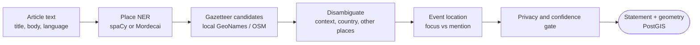
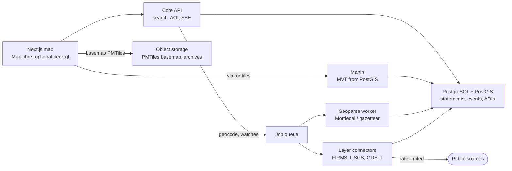

# CoreNews News Map: Research & Design

Research into how CoreNews should show where news is happening: a recommended MapLibre rendering stack, free or self-hosted basemaps, how to geolocate articles, official geo event layers, UX patterns from live news maps, and a PostGIS architecture sketch. Facts were checked against official docs on 20 November 2026 (America/New York). Pricing and limits that could not be confirmed are marked unverified. This is research only; no application code was changed.

## Contents

- [Recommendation at a glance](#rec)
- [How this fits the system spec](#spec)
- [Map rendering stack and licensing](#stack)
- [Basemaps and tiles](#basemaps)
- [Geolocating news](#geolocate)
- [Geo event layers](#layers)
- [UX patterns and feature set](#ux)
- [Data and architecture](#arch)
- [Licensing, privacy, and open decisions](#legal)
- [Sources and unverified items](#sources)

## Recommendation at a glance

| Value | Label | Detail |
| --- | --- | --- |
| MapLibre GL JS | Recommended renderer | plus deck.gl later for heatmaps |
| OpenFreeMap or Protomaps | Recommended basemap | do not use OSM.org tiles in production |
| Martin + PostGIS | Recommended tile path | tippecanoe for static archives |
| GEO-1 and GEO-2 | Spec alignment | v1 map; Copernicus imagery later |

> **Recommended stack** Use MapLibre GL JS in the Next.js app, with PostgreSQL 16 and PostGIS as the system of record. Serve a self-hostable vector basemap (copy Protomaps daily PMTiles to your own storage, or start on OpenFreeMap's public instance and plan a self-hosted fallback). Add deck.gl's official MapLibre overlay only when heatmaps or very large point clouds need it. Geolocate news first from GDELT's existing coordinates, then from a self-hosted geoparser (Mordecai 3 or spaCy plus a local gazetteer). Never send production bulk geocoding to nominatim.openstreetmap.org.

MVP map features: clustered news pins with confidence and source, layer toggles for NASA FIRMS, USGS earthquakes, NASA EONET, GDACS, and US NWS alerts, a time slider, topic and source filters, click-through from a pin to the statement, entity, and article, areas of interest, GeoJSON export, and visible attribution. Leave aircraft, AIS, ACLED, and commercial-only feeds until licenses are cleared.

## How this fits the system spec

*The CoreNews system spec on main already chose MapLibre and PostGIS. This page elaborates the news-map design without changing that decision.*

| Spec item | What it already says | What this research adds |
| --- | --- | --- |
| Frontend | TypeScript, React, Next.js, MapLibre GL for maps | Confirm MapLibre; add deck.gl later; reject OSM.org raster tiles as the production basemap |
| Database | PostgreSQL 16 with PostGIS | Schema for statement geometries, geo events, and areas of interest; Martin for vector tiles |
| GEO-1 (P2 / v1) | MapLibre map with FIRMS, USGS, OpenSky, AIS, and approximate IP location with a disclaimer | Ship FIRMS and USGS in MVP; hold OpenSky and AIS until a written license is in place |
| GEO-2 (P2 / v1) | Areas of interest, time slider, entity-to-location links, GeoJSON export | Treat these as MVP map features, plus clustering, filters, and pin-to-entity linking |
| GEO-3 (P3 / v2) | Satellite imagery browsing from Copernicus | Optional Cesium globe can wait for the same phase |
| MON-3 | Alerts include fire detection in an AOI and aircraft or vessel geofences | AOI alerts can start with fires and earthquakes; vehicle geofences depend on license clearance |
| Privacy | Do not identify a household or person from GeoLite or IP location | Extend that rule to news geoparsing: do not pin private residences |

## Map rendering stack and licensing

*Library licenses were read from official repositories or project sites on 20 November 2026. Tile and data licenses are separate and are covered in the basemap section.*

| Library | License | Role | Verdict for CoreNews |
| --- | --- | --- | --- |
| MapLibre GL JS | BSD-3-Clause | GPU vector-tile maps in the browser; no library access token; community fork of Mapbox GL JS 1.x | Recommended renderer. Already named in the system spec. |
| deck.gl | MIT (vis.gl / OpenJS Foundation) | Large-point, heatmap, and arc overlays. Official MapLibreOverlay supports MapLibre GL JS v4.5.1, v5, and v6. | Add in v1 or v2 when heatmaps or tens of thousands of points are needed. Not required for MVP pins. |
| Leaflet | BSD-2-Clause | Lightweight raster/vector maps. The library is free; you still need a tile source. | Useful for a simple embed or print map. Too limited as the primary product map. |
| OpenLayers | BSD-2-Clause | Very capable 2D GIS client (many projections and formats). | A solid alternative, but a weaker fit for a MapLibre-style vector basemap and a smaller team. |
| CesiumJS | Apache-2.0 | 3D globes and terrain. Free for commercial and non-commercial use. | Optional later, alongside Copernicus imagery (GEO-3). Not the default 2D workbench. |
| kepler.gl | MIT | An analysis workbench for exploring geospatial datasets, not a product map component. | Useful internally for data review. Do not build the CoreNews map on it. |

### Pros

- MapLibre is open-source, has no per-seat or map-load fee, and is already the spec choice.
- It renders vector tiles, which you can self-host as PMTiles or serve from PostGIS via Martin.
- deck.gl can be layered on later without replacing the map.

### Cons

- MapLibre does not include tiles, geocoding, or satellite imagery. Those are separate sources with their own terms.
- Styles forked from Mapbox are not automatically compatible with every newer Mapbox-only feature.
- A 3D globe would be a second client (Cesium), not a MapLibre switch.

## Basemaps and tiles

*The library can be free while the tiles are not. Do not point a production CoreNews map at tile.openstreetmap.org.*

> **Do not use the OSM.org tile servers as your product basemap** OpenStreetMap data is free under the ODbL. The raster tiles at tile.openstreetmap.org are not a general-purpose CDN. The official Tile Usage Policy requires identifiable User-Agent and Referer headers, visible attribution, and caching for at least seven days if you cannot honor cache headers. Bulk download, prefetch, and offline use are prohibited. Commercial services are explicitly warned that access can be withdrawn at any time. Use a self-hosted or third-party OSM-derived service instead.

| Option | Cost and limits (verified) | License / attribution | Fit |
| --- | --- | --- | --- |
| OpenFreeMap public instance | No registration, API key, or stated map-view limit. Commercial use is allowed. No SLA. Offline downloads limited to 3,000 tiles or 50 MB, at most four parallel requests, with a unique app User-Agent. Terms last updated 14 October 2026. | Project is MIT. Map data is from OpenStreetMap. Attribution required: OpenFreeMap, OpenMapTiles, and OpenStreetMap. MapLibre adds attribution automatically. | Fastest path to a working map. Use for development and early MVP, with a self-hosted fallback if the public instance is withdrawn. |
| Protomaps PMTiles (self-hosted) | Daily planet basemap builds are published for you to copy to your own storage. Official docs discourage hotlinking those URLs. A full planet archive is roughly 120 GB for zooms 0 to 15. You can extract a region or a lower max zoom. The format is a single file read with HTTP range requests from S3-compatible storage. Implementation is BSD-3-Clause; the spec is CC0. | OSM-derived Produced Work under the ODbL. Show © OpenStreetMap (recommended credit also includes Protomaps). | Recommended production basemap. One file, no tile server to run, and you control availability. |
| OpenFreeMap self-hosted | Weekly full-planet downloads are offered in Btrfs, MBTiles, and PMTiles. The production setup is open source. | Same attribution as the public instance, plus OSM ODbL obligations on the data. | Good fallback if you outgrow the public instance and want their styles. |
| MapTiler Cloud Free | $0. Official pricing (checked 20 November 2026): 5,000 map sessions per month, 1,000 search sessions, 2,000 3D sessions, 5 GB storage limited to one file. MapTiler logo required. Described as suitable for testing, PoC, prototyping, personal, or non-commercial use. Commercial use is a paid-plan feature. On the free plan, service pauses until the next month if you hit the limit. Flex starts at $30 per month. | Provider terms plus OSM attribution. Not legal advice. | Fine for a short prototype. Not a foundation for a commercial product. |
| Stadia Maps Free | $0 and 200,000 credits per month. Standard vector tiles cost 1 credit per tile. Commercial use is not allowed on the free tier. After credits are exhausted, APIs return HTTP 429 until the next cycle unless you enable paid overage on a paid plan. Proxying and bulk download are generally prohibited. | Provider terms plus OSM attribution. | Useful for evaluation. Move to a paid plan or self-host before any commercial deployment. |
| Natural Earth | Public-domain vector and raster data at 1:10m, 1:50m, and 1:110m. No permission or payment required. Attribution is optional ("Made with Natural Earth"). | Public domain, as stated on naturalearthdata.com terms of use. | Use for low-zoom political context, country choropleths, and static overview maps. Not a street-level basemap. |

Recommendation: develop against OpenFreeMap's public styles (Liberty, Positron, Dark, and similar) so the map works on day one, and put a Protomaps PMTiles file on CoreNews object storage as the production default. Keep the style URL configurable so you can switch providers without a client release, which is also what the OSMF tile policy recommends in general. Always show OSM attribution in the map corner and in exports.

## Geolocating news

*The hard problem is not drawing a pin. It is deciding which place a story is actually about, with a confidence score, and refusing to pin private homes.*

### Start with coordinates that already exist

The GDELT Project publishes already-geocoded news at global scale. Official terms (gdeltproject.org, retrieved 20 November 2026) state that GDELT datasets are available for unlimited and unrestricted academic, commercial, or governmental use without fee, and that redistribution is allowed if you cite the GDELT Project and link to https://www.gdeltproject.org/.

- GDELT Event Database 2.0: each event has Actor1Geo, Actor2Geo, and ActionGeo fields (location type, full name, country and ADM1 codes, latitude, longitude, and a feature ID). ActionGeo is usually the better pin for 'where it happened.'
- GDELT Global Knowledge Graph: V1LOCATIONS and V2ENHANCEDLOCATIONS list every location mentioned in an article, with type, name, country, ADM codes, lat/lon, feature ID, and (in V2) a character offset into the text.
- GDELT GEO 2.0 API: official keyword-to-map service over roughly the last seven days, updated every 15 minutes. Modes include point data, country and ADM1 polygons, heatmaps, and animation, with HTML maps or GeoJSON. Useful as a UX reference and as a bootstrap, not as CoreNews's only geocoder.
- Treat GDELT coordinates as a sourced statement with a method of 'gdelt' and a moderate default confidence. GDELT geocoding can attach a story to a country centroid or confuse two places that share a name. CoreNews should store that uncertainty rather than hide it.

### When CoreNews must geocode its own text

| Tool | What it is | Production guidance |
| --- | --- | --- |
| Mordecai 3 | Python geoparser by Andy Halterman. spaCy transformer NER, GeoNames candidates in a local Elasticsearch index, and a neural ranker. Can also do event geocoding with a question-answering model ('where did this event occur?'). Returns lat/lon, GeoNames IDs, admin hierarchy, and a score. Reported accuracy in the author's write-up is 94 on the author's evaluation sets. | Strong default for English news event location. Requires a local GeoNames index. Confirm current language coverage and model size before committing. License of the library should be re-read at install time (not re-verified in the repo this turn). |
| CLIFF-CLAVIN | MIT Media Lab / Media Cloud geoparser built for news. Designed to find a story's geographic focus, not only every place mentioned. HTTP parse API historically returned people, organizations, mentions, and focus cities, states, and countries. | Conceptually the right 'focus vs mention' split. Check current maintenance of mediacloud/cliff-annotator before building on it. |
| spaCy + GeoNames | Use spaCy NER for GPE and LOC, then resolve against a local GeoNames dump (CC BY; commercial use allowed with credit). The official GeoNames web service is limited to 10,000 credits per day and 1,000 per hour per username. | Fine as a simpler pipeline, especially if Mordecai is too heavy. Prefer the local dump over the public web service for bulk work. |
| Pelias | Open-source geocoder (MIT). Official docs support self-hosting, including a Docker setup, against OSM and other gazetteers. | Good self-hosted search-box and forward-geocoding service for 'what's happening near X.' |
| Nominatim (public) | Official OSMF policy for nominatim.openstreetmap.org: absolute maximum of 1 request per second, valid identifying User-Agent or Referer, OSM attribution, ODbL share-alike. No autocomplete. No systematic or grid queries. Bulk geocoding is discouraged. Apps must be able to switch the service without a software update. Commercial users are warned that access can be withdrawn. | Do not use the public instance for CoreNews production or batch article geocoding. Self-host if you want Nominatim. |
| Photon | Komoot's OSM search API (including a public demo at photon.komoot.io). Official terms: you may use it for a project, but extensive usage will be throttled, and availability is not guaranteed. | Self-host for production. The public demo is only for experiments. |
| OpenCage | Commercial geocoder with an official free trial: 2,500 requests per day, 1 request per second, files up to 100 rows, no credit card, testing only. Inactive trial accounts are deleted after three months. Paid plans start at $50 per month for 10,000 requests per day. Results may be stored permanently, including after you leave. | Useful as a paid fallback for interactive place search. Do not build batch news geocoding on the trial. |

### Confidence, disambiguation, and privacy

- Store both 'mentioned' and 'occurred_at' (or focus) locations. A Paris climate summit should not also pin every other city named in passing at the same weight.
- Keep method, gazetteer ID (GeoNames or OSM), raw text span, and a 0 to 1 score on every geo statement, consistent with the Admiralty-style confidence already in the spec.
- Use document context: other places in the article, source country, language, and admin hierarchy. Prefer city and landmark matches over country centroids when the text supports it.
- When two candidates remain close in score, show an ambiguous pin or a country-level fallback rather than a false city.
- Do not geocode private individuals' home addresses, even if a story mentions a street. Pin a city, neighborhood, or 'location withheld.' The same rule already exists in the spec for GeoLite and IP location: approximate location only, with a visible precision disclaimer.
- Nominatim and OSMF policies also say not to submit personal or confidential data to their public services. That is another reason to self-host and to strip street-level personal addresses before geocoding.
- IP geolocation of a news outlet or a commenter is not the event location. If shown at all, it must be labeled approximate and coarsened.

## Geo event layers

*Overlay official hazard and context layers under news pins. License status is a product switch, as in the system spec. Not legal advice.*

| Layer | Official access (verified) | License / constraints | When to ship |
| --- | --- | --- | --- |
| USGS earthquakes | GeoJSON feeds at earthquake.usgs.gov, including past hour, day, and 7 days, plus the FDSN query API. Features include magnitude, place, time, and a point (lon, lat, depth). | US government open data. No fee described on the feed documentation. Show USGS attribution. | MVP. Named in GEO-1. |
| NASA FIRMS fires | MAP_KEY already provisioned for CoreNews. Official limit: 5,000 transactions per 10-minute interval; larger date ranges may count as multiple transactions. Area, standard, and map-service APIs are documented. | Use with attribution. Already listed in the spec as clear with attribution. | MVP. Named in GEO-1. Cache aggressively against the 10-minute budget. |
| NASA EONET | v3 API at eonet.gsfc.nasa.gov, including /api/v3/events/geojson. Filters for category, source, status, days, date range, magnitude, and bbox. Events can be points or polygons (wildfires, storms, volcanoes, and similar). | NASA public API; honor the site disclaimer. No API key was required in the official v3 docs retrieved this turn. | MVP. Complements FIRMS with multi-hazard events. |
| GDACS | Official feed reference lists popular event feeds updated every 6 minutes (last 24 hours, last week, plus hazard-specific earthquake, cyclone, and flood feeds). A programmatic API also exists on the gdacs.org domain. | UN / European Commission cooperation framework. Re-read current terms and confirm the exact API contract before shipping. Feed existence is verified; fine-grained API limits were not fully audited this turn. | MVP, starting with the official feeds. |
| NWS alerts (US) | api.weather.gov. Alerts are GeoJSON by default. Example: /alerts/active?area={state}. Free to use for any purpose as a US public service. A unique User-Agent that includes contact information is required. A rate limit exists but is not published; exceeded requests error and may be retried after a short interval, typically within 5 seconds. | Open US government data. US-only coverage. | MVP as a United States layer, not a global one. |
| UCDP GED | Uppsala Conflict Data Program Georeferenced Event Dataset, with village-level coordinates and day-level dates. Official download center: datasets are free and licensed CC BY 4.0, with required citation of the listed publications. The API is free, but you must request a token by email describing intended use; send it as header x-ucdp-access-token. Current GED API version observed: 26.1. | CC BY 4.0 with citation. Token access is reviewed. Still record this in the connector manifest. | v1 historical conflict layer, after the token is granted. |
| ACLED | API access requires a myACLED account and OAuth (access token valid 24 hours, refresh token 14 days). Default page size documented at 5,000 rows with pagination. | EULA last updated 1 November 2026: commercial entities may not use the content or platforms without a corporate license. Governments and multilaterals need a public-sector license. Follow the attribution and content-usage policies. The system spec already flags ACLED redistribution rules. | Not in commercial mode until a license is signed. Research-only mode only if the EULA allows that account type. |
| ReliefWeb | Official API at api.reliefweb.int/v2. Every request needs a pre-approved appname. Covers reports, disasters, jobs, and related humanitarian data. | ReliefWeb Terms grant permission to download materials for personal, non-commercial use, without resale, redistribution, or derivative works, unless more specific terms apply. Materials may still belong to original sources. Seek written clarification before using this as a product layer. | Hold for commercial mode. Possible internal-research prototype after appname approval. |
| OpenSky aircraft | REST API and OAuth client already set up for CoreNews. | Official terms: the default license is non-profit research and education only. Any for-profit or commercial entity needs a written license, including government contractors. Operational use of the REST API in a live product or automated system also needs a written agreement, even for non-profits. Contact contact@opensky-network.org. | Named in GEO-1, but do not enable in a live product until written permission exists. |
| AIS vessels | AISStream documents a free WebSocket at wss://stream.aisstream.io/v0/stream. Bounding boxes are required. Limits include 3 subscribed connections per account and per IP, a subscription within 3 seconds, at most one subscription update per second, and 200 MMSI filters. Browser clients are not permitted; you must proxy from your server. No SLA. Uncompressed connections face bandwidth limits starting September 2026. | Commercial-use and redistribution terms were not found on an official terms page this turn (marked unverified). Do not assume the free stream may be republished in a paid product. | Prototype behind a server proxy after terms are confirmed. Same GEO-1 caveat as OpenSky. |
| Cloudflare Radar outages | Official API: GET /client/v4/radar/annotations/outages with a Cloudflare API token that has Radar read permission. Filters include location, ASN, date range, outage cause, and outage type. | Requires a Cloudflare account and token. Rate limits and whether a free account is sufficient for production were not confirmed on the pricing pages this turn (unverified). | v1 or v2 internet-outage overlay, after account limits are confirmed. |
| IODA outages | Georgia Tech InetIntel operates the IODA dashboard for macroscopic internet outages. | A public API is widely referenced, but the official landing page retrieved this turn did not yield a clear, citable API contract. Treat endpoints and keyless access as unverified until official docs are saved in the connector manifest. | Later, after documentation is confirmed. |
| Sanctions and company HQs | OFAC and other official lists already planned in the spec often include address text, not coordinates. GLEIF records legal entity addresses. Wikidata often has coordinates for organizations and places. | Official sanctions lists are generally usable with attribution, as in the spec. Geocoding those addresses must follow the privacy gate: organization HQ or listed address, never a private home. | v1: geocode organization HQ and listed sanctions addresses to city or street only when the record is clearly an organization location. |

## UX patterns and feature set

*Liveuamap and GDELT GEO 2.0 were read from first-party pages. Commercial platforms such as Dataminr, Flashpoint, and Recorded Future were not audited feature-by-feature this turn; their public positioning is noted only at a high level.*

| Reference | What is verified or safely observed | Takeaway for CoreNews |
| --- | --- | --- |
| Liveuamap | First-party about page: a map-centric news site for conflicts, protests, disasters, and related topics, with regional maps, a chronological archive, human editorial review, notifications in the apps, and a PRO tier that adds an ad-free experience and satellite maps. Enterprise API is offered separately. | The product is the map plus a reviewed event stream, not a raw firehose. Region focus, archive, and 'follow this area' are the patterns to copy. Do not scrape Liveuamap; build our own sourced events. |
| GDELT GEO 2.0 | Official blog: keyword or boolean query over recent multilingual news, interactive maps at landmark, ADM1, and country levels, heatmaps and animation modes, embeddable HTML, and GeoJSON. Updated every 15 minutes. Can filter out coarse country mentions. | Offer both a global pulse map and a query-driven 'map this topic' mode. Let users hide country-centroid noise. Animation and heatmaps are proven, but they are not required for MVP pins. |
| ACLED and UCDP public maps | Both projects publish official charts or encyclopedias alongside georeferenced events, typically filterable by time, place, and violence type. | Conflict layers need time, event-type, and severity or fatality filters, plus citation of the dataset. |
| Commercial OSINT / alerting maps | Dataminr, Flashpoint, and Recorded Future publicly market geospatial alerting and monitoring. Their current UI details were not independently verified this turn. | Do not treat unverified competitor screenshots as requirements. Match them on AOI alerts, provenance, and speed, using official free layers first. |

### Patterns to build

- Clustering at low zoom, with counts, expanding to individual pins at high zoom. Never drop 50,000 unclustered GeoJSON points into the browser.
- Heatmaps for density (protests, fires, mentions of a keyword) once deck.gl is in place.
- A time slider and optional playback, defaulting to the last 24 hours or 7 days, with a clear 'live' refresh.
- Story or event clusters: several articles about the same incident should collapse to one event card with member stories, not ten stacked pins.
- Severity and confidence styling: magnitude, alert level (for example GDACS green / orange / red or NWS warning vs watch), and a muted style for low-confidence geocodes.
- Filters for layer, topic or GDELT theme, source, language, confidence, and time.
- Place search: 'what's happening near X' using a self-hosted Pelias or Photon geocoder, then a radius or admin-unit query.
- Region watchlists and areas of interest, with alerts when a new fire, quake, or high-confidence news event appears inside them.
- Click a pin to open the statement, the Location or Event entity, related graph neighbors, and an action to attach the event to a case.
- Persistent attribution for every visible layer, also written into GeoJSON and PDF exports.

### MVP versus later

#### MVP (aligns with GEO-1 and GEO-2)

- MapLibre map with a configurable vector basemap and required attribution
- Clustered news pins from GDELT plus any CoreNews-geoparsed articles, with confidence badges
- Toggles: FIRMS, USGS, EONET, GDACS, NWS (US)
- Time slider (live, 24h, 7d, custom)
- Filters: topic, source, language, confidence
- Pin opens article, statement provenance, and entity page
- Search a place and list nearby events
- Draw or save an area of interest
- GeoJSON export with source and license columns
- Approximate IP or MaxMind location only with a precision disclaimer

#### Later (v1 polish and v2)

- deck.gl heatmaps and keyword animation (GDELT-style playback)
- Story clustering and 'same incident' grouping
- AOI alerts (fires first, then news and official hazards)
- Link pins onto the investigation graph and into cases as artifacts
- UCDP historical conflict layer (after token and citation)
- ACLED only with a proper license
- OpenSky and AIS only with written terms clearance, proxied from the server, bounded retention
- Cloudflare Radar or IODA outages, after docs and account limits are confirmed
- Sanctions and company HQ pins
- Cesium globe and Copernicus imagery (GEO-3)
- Multi-tenant layer visibility driven by the license gate

## Data and architecture

*Fits the existing modular monolith: FastAPI, Postgres-backed workers, Redis for quotas, and the Next.js client talking only to the Core API.*

### PostGIS schema sketch

Keep the statement-centric model from the spec. Geometry is an attribute of a statement or of a first-class Event or Location entity, never a fact without provenance. Use geography(Point, 4326) or geometry with SRID 4326, plus a precision enum (point, city, adm1, country, approximate, withheld).

| Table | Purpose | Essential fields |
| --- | --- | --- |
| location (entity) | Canonical places | id, name, country, adm1, geonames_id, osm_id, geom, bbox, license |
| statement | Existing unit of fact | entity, property, value, source, retrieved_at, confidence, license, raw_ref |
| statement_geo | Where a statement is located | statement_id, location_id, role (occurred_at, mentioned, reported_from, hq, approximate_ip), method, score, text_span, geom, precision |
| geo_event | Normalized layer events and story clusters | source, source_event_id, category, title, geom (point or polygon), start_at, end_at, severity, properties jsonb, license, raw_ref, collected_at |
| area_of_interest | Watch regions | tenant_id, name, geom, alert_types, created_by |
| geo_alert | Dedupe deliveries | aoi_id, geo_event_id or statement_id, issued_at, status |

- Unique index on (source, source_event_id) so connectors are idempotent.
- GiST indexes on every geometry column; btree indexes on start_at, category, and source.
- Views that Martin can publish, already filtered by license mode, time window, and tenant visibility.
- Store polygons for NWS and some EONET hazards; do not reduce every alert to a centroid.

### Vector tiles and live updates

| Tool | License / notes | Use |
| --- | --- | --- |
| Martin | MapLibre project; dual MIT or Apache-2.0. Official docs: PostGIS 3.5+ on PostgreSQL 12+. Serves tables, functions, MBTiles, and PMTiles. | Recommended dynamic MVT server for news pins and event layers. Keep it internal; the browser should only fetch tiles through your API or a locked-down Martin path. |
| pg_tileserv | Crunchy Data; Apache-2.0. Serves Mapbox Vector Tiles directly from PostGIS tables and functions. | Simpler alternative if you want a PostGIS-only tile process. Martin is the better long-term fit because it also serves PMTiles and is in the MapLibre org. |
| tippecanoe | Felt; BSD-2-Clause. Builds MBTiles or PMTiles from GeoJSON, with attribution metadata flags. | Use for static or slowly changing sets: Natural Earth, historical heatmaps, country polygons, archived events. Not for live aircraft. |

- Basemap: static PMTiles on object storage, not generated from the CoreNews database.
- Dynamic layers: Martin MVT from PostGIS views, with query parameters or separate layer sources for time and filters. Cluster in SQL or in the tile at low zoom.
- Real time: connectors poll GDELT, USGS, EONET, GDACS, NWS, and FIRMS on a schedule inside their quota. The API pushes compact event IDs to subscribed clients over SSE (simpler, enough for minute-scale news). Use WebSockets later for higher-rate vessel or aircraft streams, still fan-out only for the client's viewport or AOIs.
- Do not stream raw AIS or OpenSky feeds to the browser, even after licensing: official AISStream docs already forbid direct browser connections, and the volume would overwhelm the client.
- Scale targets from the spec (about 100 million statements at v1) mean tiles and clusters, not raw GeoJSON. Cap any feature endpoint (for example a few thousand points) and let tiles carry the rest.
- Cache tiles and connector responses; honor FIRMS and NWS budgets; show stale-while-revalidate timestamps on the map.

## Licensing, privacy, and open decisions

*Not legal advice. Re-read current terms before shipping a layer in commercial mode.*

> **The license gate still applies on the map** A visible layer is a form of redistribution. The same commercial-use switch from the system spec should hide or disable OpenSky, AIS (until terms are confirmed), ACLED, ReliefWeb, and any other non-cleared source when a tenant is in commercial mode. Attribution for OSM, GDELT, FIRMS, USGS, UCDP, and others must appear on the map and in exports.

### Open decisions before implementation

1. Production basemap: OpenFreeMap public instance with a documented fallback, or Protomaps PMTiles on CoreNews storage from day one?
2. Geoparser: Mordecai 3 with a local GeoNames index, or a lighter spaCy plus self-hosted Pelias or Nominatim?
3. Ask OpenSky for a written operational license now, or keep aircraft off the live map?
4. Is an ACLED corporate (or other) license worth it for a best-in-class conflict layer, or is UCDP GED enough at first?
5. Seek written ReliefWeb guidance before using their API in any product context, given the personal non-commercial language in their terms.
6. Confirm AISStream commercial and display terms in writing before prototyping a vessel layer.

### Suggested next research steps (no code)

1. **Decide the basemap and geocoder.** Pick OpenFreeMap plus Protomaps, and pick Mordecai 3 or a self-hosted gazetteer, so the other coding agent has a stable ADR.
2. **Request access where needed.** UCDP API token, optional OpenSky commercial license, optional ACLED license, ReliefWeb appname, Cloudflare Radar token if outages are in scope.
3. **Write connector manifests.** Record license, attribution text, rate limits, and cache TTL for each layer in the existing connector framework, without putting secrets in the repo.

## Sources and unverified items

*Checked 20 November 2026, America/New York. Official pages can change; re-verify at implementation time.*

- Verified from official pages: MapLibre, deck.gl, Leaflet, OpenLayers, CesiumJS, and kepler.gl licenses; OSMF tile and Nominatim policies; OpenFreeMap site and terms (14 October 2026); Protomaps docs and legal; MapTiler and Stadia official pricing; Natural Earth terms; OpenCage pricing; Photon terms; GeoNames export terms; GDELT about/terms and GEO 2.0 blog; USGS GeoJSON feeds; FIRMS MAP_KEY docs; EONET v3; GDACS feed reference; NWS API docs; ACLED getting-started and EULA (1 November 2026); UCDP download center and API docs; ReliefWeb API docs and terms; OpenSky terms; AISStream documentation; Cloudflare Radar outages API and first-request guide; Martin installation docs; tippecanoe and pg_tileserv licenses; Liveuamap about page.
- Unverified or only partly verified: AISStream commercial-use and redistribution terms (no official terms page found); IODA public API contract; Cloudflare Radar production rate limits and free-plan sufficiency; exact GDACS API quotas; current maintenance and license file of Mordecai 3 and CLIFF at install time; feature-level teardowns of Dataminr, Flashpoint, and Recorded Future; any dollar amounts not listed above.
- This research did not change the CoreNews repository or application code. The other coding agent remains the place for implementation.

- [CoreNews system spec on GitHub](../spec/SYSTEM_SPEC.md) — GitHub
- [CoreNews OSINT Source Catalog](./SOURCE_CATALOG.md)
- [CoreNews Competitive Gap Analysis](./COMPETITIVE_GAP_ANALYSIS.md)
- [CoreNews System Spec & Build Roadmap](../README.md)
