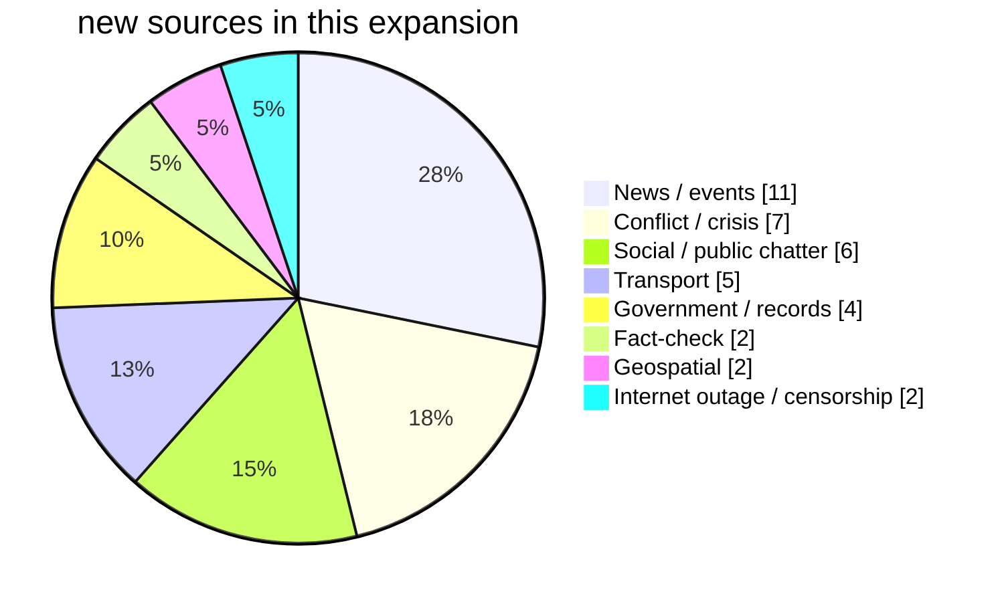
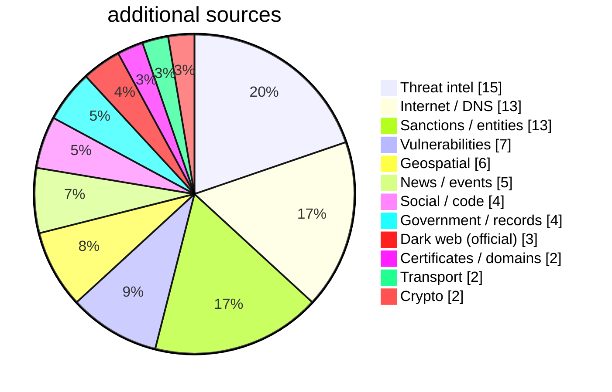

# CoreNews OSINT Source Catalog

The original 76-source catalog (18 November 2026) plus a clearly marked news and maps expansion of 39 additional sources, verified from official pages on 20 November 2026 (America/New_York). Already-provisioned keys are listed first. Sources already in the earlier catalog were not repeated.

**Sources recorded on this page**

- News and maps expansion reviewed from official provider pages on 20 November 2026 (America/New_York)
- Original 76-source catalog reviewed 18 November 2026
- Limits or licenses that could not be confirmed on an official page are marked Unverified or check docs
- Existing CoreNews keys: Shodan, Censys, VirusTotal, OTX, AbuseIPDB, urlscan.io, Hunter, NVD, api.data.gov (OpenFEC and Congress.gov), IPinfo Lite, NASA FIRMS, DNSDumpster, MaxMind GeoLite2, OpenSky

## Contents

- [News and maps expansion totals](#expansion-metrics)
- [Original catalog totals](#original-metrics)
- [Already in CoreNews](#already)
- [News and maps expansion](#expansion)
- [First ten to add](#first-ten)
- [Signups to offer](#expansion-signups)
- [Original source catalog](#catalog)
- [Recommended next signups](#signups)
- [Keyless quick wins](#keyless)
- [Licensing and ethics](#licensing)

> **Licensing first.** CoreNews may become a product. Several otherwise excellent free tiers are non-commercial, evaluation-only, or require a paid API for commercial use. Prefer clearly licensed government and CC0 sources for anything that ships, and re-read terms before launch. This catalog lists only legitimate public APIs and official bulk data, not leaked databases or ToS-violating scrapers.

## News and maps expansion totals

*Counts for the 20 November 2026 expansion tab, with no filters applied.*

| Value | Label | Detail |
| --- | --- | --- |
| 39 | New sources in this expansion | Deduped against the 18 November catalog |
| 17 | High priority | Best next integrations for news and maps |
| 21 | Keyless or bulk | Can start without a new account |
| 12 | Signup or request useful | Free key, free account, or emailed token |
| 13 | Clearly commercial-friendly | Yes, attribution, or public domain |
| 13 | Have usable geo fields | Coordinates, GeoJSON, tiles, or NUTS codes |

## Original catalog totals

*Counts for the 18 November 2026 catalog tab, with no filters applied.*

| Value | Label | Detail |
| --- | --- | --- |
| 76 | Additional sources | Beyond the already-integrated set |
| 43 | High priority | Best next integrations |
| 36 | Keyless or bulk | Can start without a new account |
| 42 | Need a free account | Candidates for OpenIntel registration |
| 27 | Clearly commercial-friendly | Yes, attribution, or public domain |

## Already in CoreNews

*Do not treat these as new finds. Keys added since the 18 November catalog (NVD, IPinfo Lite, OpenFEC, Congress.gov, DNSDumpster, NASA FIRMS, MaxMind GeoLite2, OpenSky) are listed here. URLhaus and ThreatFox still need an abuse.ch Auth-Key, which was skipped.*

| Source | Status | Notes |
| --- | --- | --- |
| [Shodan](https://developer.shodan.io/) | API key in CoreNews .env | Internet-wide device and service search. |
| [Censys](https://accounts.censys.io/settings/personal-access-tokens) | API token in CoreNews .env | Hosts, certificates, and internet inventory. |
| [VirusTotal](https://www.virustotal.com/gui/my-apikey) | API key in CoreNews .env | File, URL, domain, and IP reputation. |
| [AlienVault OTX](https://otx.alienvault.com/settings) | API key in CoreNews .env | Community pulses and IOC context. |
| [AbuseIPDB](https://www.abuseipdb.com/account/api) | API key in CoreNews .env | IP abuse reports and confidence scores. |
| [urlscan.io](https://urlscan.io/user/profile/) | API key in CoreNews .env | URL detonations and related infrastructure. |
| [Hunter](https://hunter.io/api-keys) | API key in CoreNews .env | Free plan, 50 email-search credits/month. |
| [NVD](https://nvd.nist.gov/developers/request-an-api-key) | API key in CoreNews .env | Canonical CVE, CPE, and CVSS data. |
| [IPinfo Lite](https://ipinfo.io/developers/lite-api) | Token in CoreNews .env | IP-to-ASN and country enrichment. |
| [OpenFEC](https://api.open.fec.gov/developers/) | api.data.gov key in CoreNews .env | U.S. federal campaign finance. Same key type as Congress.gov. |
| [Congress.gov](https://api.congress.gov/sign-up/) | api.data.gov key in CoreNews .env | Bills, members, and committee activity. |
| [DNSDumpster](https://dnsdumpster.com/developer/) | API key in CoreNews .env | Subdomain and DNS reconnaissance. |
| [NASA FIRMS](https://firms.modaps.eosdis.nasa.gov/api/map_key) | MAP_KEY in CoreNews .env | Near-real-time fire detections. |
| [MaxMind GeoLite2](https://www.maxmind.com/en/geolite-free-ip-geolocation-data) | License key in CoreNews .env | Offline IP geolocation and ASN database. |
| [OpenSky Network](https://openskynetwork.github.io/opensky-api/rest.html) | API client credentials in CoreNews .env | Worldwide ADS-B state vectors and flight histories. |
| [GreyNoise](https://docs.greynoise.io/) | Account only; no personal API key | Community API remains usable at low volume without a key. |
| [URLhaus / ThreatFox](https://auth.abuse.ch/) | Suggested earlier as keyless; now needs Auth-Key | Register one abuse.ch Auth-Key to restore programmatic access and add MalwareBazaar, Feodo, and SSLBL. |
| [crt.sh](https://crt.sh/) | Keyless, already suggested | Certificate Transparency search. |
| [Wayback CDX](https://github.com/internetarchive/wayback/tree/master/wayback-cdx-server) | Keyless, already suggested | Historical URL capture index. |
| [GDELT DOC API](https://blog.gdeltproject.org/gdelt-doc-2-0-api-debuts/) | Keyless, already suggested | Global news and event text query API. |
| [RDAP](https://about.rdap.org/) | Keyless, already suggested | Standard domain, IP, and ASN registration data. |
| [Common Crawl](https://commoncrawl.org/) | Keyless / bulk, already suggested | Open web crawl corpora. |
| [BGPView / RIPEstat](https://stat.ripe.net/docs/02.data-api/) | Keyless, already suggested | Routing, prefix, and ASN telemetry. |
| [Pwned Passwords](https://haveibeenpwned.com/API/v3#PwnedPasswords) | Keyless range API; breach API is paid | HIBP full breach API was skipped. Range API stays free for password k-anonymity checks. |
| [OpenSanctions](https://www.opensanctions.org/docs/bulk/) | API is grant-only; bulk data is CC BY-NC | Use official OFAC, EU, UN, and UK lists for product screening. Bulk OpenSanctions is non-commercial. |

> **News and maps expansion, 20 November 2026 (America/New_York).** This tab is the new research set for a news-centric product: global news and events, fact-checks, crisis alerts, maritime and aviation positions, satellite imagery, public social chatter, official legal records, and internet outage or censorship data. It is deduped against the original 76-source catalog and the already-provisioned keys. GDELT DOC, ACLED, ReliefWeb, USGS earthquakes, NASA FIRMS, Copernicus, OpenSky, AISStream, the Bluesky AppView API, Cloudflare Radar, CourtListener, SEC EDGAR, and the OFAC/EU/UN/UK lists stay in those earlier sections and are not repeated here. Several rows (AP, Reuters, Planet, ProMED, HealthMap, ADS-B Exchange) are included only to document that there is no usable free public API.

## News and maps expansion

*Filter the 20 November 2026 set. Official limits, licences, update frequency, and geo fields are in the table. Where something could not be confirmed on an official page, the cell says Unverified or check docs.*

Showing 39 of 39 new sources.

| Name | Category | Access | Free limits | Commercial use allowed? | Update frequency | Geo fields | Signup needed? | Value for CoreNews | Priority |
| --- | --- | --- | --- | --- | --- | --- | --- | --- | --- |
| [adsb.lol](https://www.adsb.lol/docs/open-data/api) | Transport | Keyless | Official docs: no key is 500 requests/day per IP; a free adhoc key is 1,000/day; feeder keys are 7,200/day and 20 GB/month. Over quota returns HTTP 429 with Retry-After; daily window resets 00:00 UTC. Data licence stated on the API page is ODbL 1.0 (share-alike, attribution). | Yes + attribution | Live aircraft positions | Latitude and longitude (and standard ADS-B fields) | No | The most practical unpaid complement to OpenSky for live aircraft positions, with a clearly stated open-database licence. | High |
| [Bluesky Jetstream](https://bsky.network/docs/jetstream/) | Social / public chatter | Keyless | Official docs: live tail on public v2 instances (wss://jetstream.us-east.bsky.network and us-west) requires no authentication and serves the full network. A subscription accepts up to 100 collections and 10,000 DIDs. Network Replay (history over HTTP, then cut over to live) uses authenticated HTTP calls. No numeric rate limit is published for the live tail. The AppView/public API is already in the earlier catalog; Jetstream is the firehose-style path. | Check terms | Live (and optional historical replay on v2) | Not inherent; place text may appear in posts | No | The right way to watch public Bluesky posts and likes as they happen, for breaking chatter around a story or place. | High |
| [EU TED Search API and bulk packages](https://docs.ted.europa.eu/api/latest/index.html) | Government / records | Keyless / bulk | Search and retrieval of already-published notices is anonymous (no key). Official fair-use policy: 700 HTTP requests in the last minute, and 600 notice visualizations or downloads per IP in less than 6 minutes; bulk daily/monthly HTTPS packages allow 3 concurrent downloads. An API key (EU Login) is needed only for unpublished-notice operations, which CoreNews does not need. | Check terms | New notices follow the Official Journal S release calendar; daily and monthly XML packages are published | NUTS place-of-performance codes (not raw lat/lon) | No | EU and related public-procurement notices, with NUTS places of performance — a structured economic and contracting feed across Europe. | High |
| [Federal Register API](https://www.federalregister.gov/developers/documentation/api/v1) | Government / records | Keyless | Official docs: no API key required. Results are paginated; you can only paginate through the first 2,000 results (use date-range filters for more). No numeric rate limit was published on the official developer pages. 1 CFR 2.6 allows any person to reproduce or republish Federal Register material without restriction. Do not use official NARA or OFR logos or seals. | Yes | As documents are filed and published, including the public-inspection desk | Agency metadata; not typically lat/lon | No | Rules, proposed rules, notices, and public-inspection documents — the official U.S. regulatory news feed, ready to map to agencies and topics. | High |
| [GDACS](https://www.gdacs.org/Documents/2025/GDACS_API_quickstart_v2.pdf) | Conflict / crisis | Keyless | Official quick start: free APIs and RSS/XML feeds, no authentication described. Search returns at most 100 records per page (use pagenumber / pagesize). Acknowledge the source as “Global Disaster Awareness and Coordination System, GDACS.” Terms (March 2025) say alerts are near-real-time with no completeness or timeliness guarantee, and should not replace official warnings. | Yes + attribution | Near-real-time (no numeric poll interval published in the official quick start) | GeoJSON (and KML for recent events) | No | Multi-hazard earthquake, cyclone, flood, volcano, and related alerts with geospatial payloads for a global crisis layer. | High |
| [GDELT 2.0 Events, Mentions and GKG](https://www.gdeltproject.org/data.html) | News / events | Keyless / bulk | No key or account. Events, Mentions, and GKG files are published every 15 minutes (lastupdate.txt / masterfilelist.txt). There is no Events/GKG query API; BigQuery is optional and billed by Google. No published download rate limit found. | Yes + attribution | Every 15 minutes | Event and actor latitude/longitude plus place names (Event codebook) | No | Georeferenced global news events (CAMEO), mention tracking, and a people/org/place/theme graph — the best free backbone for mapping where news is happening. The DOC 2.0 search API is already in the earlier catalog. | High |
| [Google Fact Check Tools API](https://developers.google.com/fact-check/tools/api) | Fact-check | Free key | Claim Search requires a Google Cloud API key. It queries the same ClaimReview corpus as Fact Check Explorer. No numeric quota is published on the Fact Check Tools overview; check the Cloud Console quota for the enabled API. Use is subject to Google's API Terms of Service. The separate ClaimReview write API is only for Search Console users of a site. | Check terms | On demand; corpus updates as publishers issue ClaimReview markup | Not typically geocoded; publisher and claim text only | Free key | The practical way to attach fact-checks to claims and stories in CoreNews. | High |
| [GovInfo API](https://api.govinfo.gov/docs/) | Government / records | Free key | Requires an api.data.gov key — CoreNews already has one (the same key type used for Congress.gov). Official GovInfo API docs did not publish a distinct numeric cap on the docs page reviewed; default api.data.gov hourly limits apply unless raised. U.S. government works are generally public domain (17 U.S.C. §105), but some packages may include third-party copyrighted material. | Yes | Collections endpoints can list packages by lastModified or publication date | Not typically point-geocoded | Existing key | Bills, the Congressional Record, the Federal Register, the CFR, and other official U.S. publications for legal and political context around a story. No new signup if the existing key is enabled for this API. | High |
| [IODA](https://api.ioda.inetintel.cc.gatech.edu/v2/) | Internet outage / censorship | Keyless | Official IODA HTTP API v2 (Georgia Tech Internet Intelligence Lab). The OpenAPI document lists no authentication and no published rate limit or licence text. Endpoints cover data sources, entity search, outage alerts/events/summary, and raw signals. Honor any HTTP 429s. Commercial and redistribution rights are unverified. | Unverified | BGP visibility is calculated every 5 minutes; Google Transparency Report inputs are described as half-hourly | Country, region, and ASN aggregations (not street-level coordinates) | No | Country-, region-, and ASN-level internet outage and disruption signals — the missing layer beside Cloudflare Radar (already in the earlier catalog). | High |
| [NASA EONET](https://eonet.gsfc.nasa.gov/docs/v3) | Conflict / crisis | Keyless | Public v3 Events API, no key. No published rate limit was found on the official v3 docs. Metadata is subject to the EONET disclaimer (extents can be approximate). | Yes + attribution | As events are opened or closed; no published poll interval | GeoJSON Point or Polygon with event dates | No | Curated natural events (wildfires, storms, volcanoes, ice, etc.) with geometries that sit alongside FIRMS and USGS, which you already have. | High |
| [NASA GIBS](https://nasa-gibs.github.io/gibs-api-docs/access-basics/) | Geospatial | Keyless | Public WMTS, WMS, TWMS, and TMS on gibs.earthdata.nasa.gov, no key described in official access docs. A bulk download is defined as more than 1,000,000 tiles in 24 hours and must be coordinated at least 48 hours ahead via earthdata-support@nasa.gov. Guidelines: keep sustained bandwidth under 50 Mbps and concurrent downloads at or below 500 threads. No general per-request cap is published. | Yes + attribution | Layer-dependent; many “best available” and near-real-time layers are daily, some are sub-daily | Map tiles in EPSG:4326, Web Mercator, and polar projections (not a point-event API) | No | Near-real-time and historical satellite imagery tiles so the map can show what a place looked like when a story broke. Complements Copernicus (already in the earlier catalog). | High |
| [NOAA / NWS API (alerts)](https://www.weather.gov/documentation/services-web-api) | Conflict / crisis | Keyless | Official docs: open data, free for any purpose, no fee. A descriptive User-Agent with contact information is required. The rate limit is unpublished but described as generous; exceeding it returns an error that may be retried after the limit clears (typically within 5 seconds). /alerts covers about the past seven days; official archives are via NCEI. | Yes | Real-time; cache-friendly expiration is built into the API | GeoJSON geometry plus area and place names | No | Authoritative U.S. watches, warnings, and advisories (and forecasts) as GeoJSON or CAP — a must for mapping domestic hazard news. | High |
| [Publisher RSS and Atom feeds](https://www.bbc.co.uk/news/10628494) | News / events | Keyless | No single global API. Many publishers (BBC documents official RSS feeds at the linked page) expose RSS or Atom without a key. Poll politely, honor each feed's terms and robots rules, and cache. Volume is whatever you subscribe to. | Check terms | Varies by publisher; often minutes to hours | Usually absent; place names may appear in titles or categories | No | Direct headlines from named wires and outlets without an aggregator licence. Pair with GDELT for structure, and treat each publisher's terms separately. | High |
| [UCDP GED and Candidate Events](https://ucdp.uu.se/Downloads/) | Conflict / crisis | Keyless / bulk | Bulk datasets are free of charge under CC BY 4.0 with required citation. The JSON API is also free but needs an access token requested by email from the API maintainer (reviewed in 3–5 working days). No published numeric API quota was found on the official API docs. Candidate Events are released monthly, with no more than a month of lag. | Yes + attribution | GED is versioned (current global GED 26.1); Candidate Events monthly | WGS84 latitude/longitude, place names, and country; API supports a bounding box | Request | Research-grade organized-violence events with village-level coordinates — essential conflict context beside ACLED (already in the earlier catalog). Start with bulk files; request an API token if you want live queries. | High |
| [Wikimedia EventStreams (recent changes)](https://wikitech.wikimedia.org/wiki/Event_Platform/EventStreams) | Social / public chatter | Keyless | Public SSE at https://stream.wikimedia.org/v2/stream/recentchange, no key. Official note: intended for small-scale external tools, not WMF production. HTTP connections are terminated after 15 minutes; a good client reconnects with Last-Event-ID. Also follow 2026 Wikimedia API rate-limit policy (compliant User-Agent; unauthenticated bots typically 200 requests/minute on request/response APIs). | Check terms | Live stream; reconnect at least every 15 minutes | Not in the event itself; join page titles to Wikidata coordinates when present | No | A live signal of what the world is editing on Wikipedia and Wikidata — often the first public spike around breaking news. | High |
| [Wikimedia Pageviews API](https://doc.wikimedia.org/generated-data-platform/aqs/analytics-api/documentation/access-policy.html) | Social / public chatter | Keyless | A descriptive User-Agent with contact details is required. Data is CC0 1.0. Rate limits follow the Wikimedia APIs policy (2026): unauthenticated clients with a compliant User-Agent are listed at 200 requests/minute; unidentified-IP-only traffic is much lower (10/minute). Honor HTTP 429 and Retry-After. Bulk dumps are also available. | Yes (public domain / CC0) | Hourly and daily pageview series (see the analytics API) | None directly; join article titles to Wikidata coordinates | No | Attention spikes on people, places, and event articles — a clean news-interest time series to plot beside GDELT. | High |
| [YouTube Data API v3](https://developers.google.com/youtube/v3/getting-started) | Social / public chatter | Free key | Google Cloud project with the API enabled. Official default quota (subject to change): 100 search.list calls, 100 videos.insert calls, and 10,000 units/day for all other endpoints. Use is subject to the YouTube API Services Terms of Service and developer policies. | Check terms | On demand; new videos as you search or list a channel | recordingDetails.location only when a creator sets it; not guaranteed | Free key | Channel, playlist, and video metadata for news outlets and eyewitness uploads — a core public-chatter source if you stay inside YouTube's terms. | High |
| [AISHub](https://www.aishub.net/api) | Transport | Free key | API key is issued only to members who share a qualifying own AIS receiver feed (at least 10 vessels coverage and 90% uptime over 7 days, ≤60s downsampling, ≤10s delay). Official limit: at most one request per minute (“Too frequent requests!” otherwise). Terms updated 8 Oct 2026 (apply to existing members from 1 Jan 2027). | Yes + attribution | Live positions; poll at most once per minute | Latitude and longitude, plus MMSI, destination, and related voyage fields | Not a free signup | Live vessel positions if you can operate a feeder. Not a simple email signup. AISStream (already in the earlier catalog) is the easier free path if you do not have a receiver. | Med |
| [ClaimReview (schema.org)](https://schema.org/ClaimReview) | Fact-check | Keyless | An open markup standard, not a standalone data API. Access structured reviews through the Google Fact Check Tools API, Data Commons, or publishers who expose ClaimReview on their pages. Do not scrape sites that forbid it. | Check terms | Whenever a publisher publishes or updates markup | Not inherent | No | The shared vocabulary behind fact-check results. Use it as the data model; do not treat it as its own feed. | Med |
| [Currents API](https://currentsapi.services/en/docs/) | News / events | Free key | Free: 250 requests/day (reset 00:00 UTC), 20 results/request, 30-day lookback, max 7-day span per search, 300-character previews. Daily cap returns HTTP 429 with Retry-After. Official docs (updated 27 Oct 2026) say every self-service plan, including Free, allows commercial use with attribution and a link to the original article. A separate terms URL was not found in this review. | Yes + attribution | Described as real-time on the free plan (no delay stated in official docs) | Language and country parameters; no guaranteed lat/lon | Free key | A news-search API whose official docs allow commercial use on the free plan, with publisher-link attribution. Re-read terms before launch; article text remains the publishers'. | Med |
| [Global Fishing Watch API](https://globalfishingwatch.org/our-apis/documentation/docs/license-rate-limits) | Transport | Free tier signup | Account and API token required (up to five tokens; limits are shared). Official cap: 50,000 requests/day and 1,500,000/month. License is CC BY-NC 4.0 with required attribution. Registration expects an organization email. Commercial or internal-commercial use needs a custom licence discussion (apis@globalfishingwatch.org); no public commercial price list. | Non-commercial only | Official attribution language describes the data as updated daily | Vessel and fishing-activity positions (coordinates) | Free account | Fishing effort, vessel identity, and apparent fishing activity for maritime OSINT — strong, but only while CoreNews remains non-commercial or a custom licence is granted. | Med |
| [Mastodon public API](https://docs.joinmastodon.org/api/rate-limits/) | Social / public chatter | Keyless | Official default limits (hardcoded): 300 requests per 5 minutes per account and per IP. Public timelines are available (GET /api/v1/timelines/public). Terms, scraping rules, and commercial reuse vary by instance — read each instance's terms. There is no single global Mastodon firehose. | Check terms | Live on each instance you query | Not inherent | No | Public posts on specific instances (newsrooms, regional, activist) as a complement to Bluesky. Plan instance-by-instance, not as one feed. | Med |
| [NewsData.io](https://newsdata.io/pricing) | News / events | Free key | Free: 200 API credits/day, 1–10 articles per credit, past 48 hours of news, 12-hour delay. Official rate limit for the free plan is 30 credits every 15 minutes (HTTP 429 when exceeded). Pricing labels the free plan “for testing & personal projects.” The license grant is “personal or internal business purposes”; product/redistribution rights are not clearly stated. | Unverified | 12-hour delay on the free plan; 48-hour history | Country and category filters; no guaranteed lat/lon | Free key | Another multilingual news API with a usable free quota for evaluation. Confirm whether a public CoreNews feature would fall inside “internal business” use. | Med |
| [OONI](https://docs.ooni.org/data/) | Internet outage / censorship | Keyless / bulk | The OONI API is for metadata, single measurements, and statistics, and is rate-limited (details are in official rate-limiting docs; exact numeric quotas were not on the data-access page). Official guidance: do not extract tens of thousands of measurements from the API — use the free S3 bucket ooni-data-eu-fra (AWS Open Data, --no-sign-request) or ask for ClickHouse dumps. Measurement data is licensed CC BY-NC-SA 4.0. | Non-commercial only | New measurements are processed quickly; S3 batches are described as uploading about once an hour | probe_cc (country) and probe_asn; not precise lat/lon | No | The leading public evidence base for website blocking and network interference, with country and ASN tags. Use S3 for bulk; keep product use inside the NC licence or get permission. | Med |
| [Open Ownership BODS datasets](https://bods-data.openownership.org/) | Government / records | Bulk download | The live Open Ownership Register closed in 2024 (already noted in the earlier catalog). What remains officially is mapped BODS analysis datasets (for example UK PSC / overseas entities and GLEIF ownership) as CSV, SQLite, JSON, and Parquet. The GLEIF and UK mappings reviewed on the official tools page are published under CC0 1.0 and dated 11 Mar 2025, with a work-in-progress caution. | Yes (public domain / CC0) | Periodic republished snapshots (not a live API) | Jurisdiction and addresses when present in the source register, not reliable coordinates | No | Static beneficial-ownership snapshots for entity resolution, not a live global register. Pair with GLEIF, Companies House, and official sanctions lists you already track. | Med |
| [Telegram Bot API (public channels)](https://core.telegram.org/bots/api) | Social / public chatter | Free key | A bot created with @BotFather receives messages from channels only where it is a member (an admin must add it). It is not a firehose of all public channels. Official FAQ: avoid more than one message per second in a single chat, 20 group messages/minute, and about 30 broadcast messages/second (HTTP 429 if exceeded). Review the Bot Developer Terms before any bulk collection. | Check terms | Live updates via long polling or webhook, for chats the bot can see | Not inherent | Free account | Useful for a curated set of public channels that grant membership to your bot, not for vacuuming Telegram at large. | Med |
| [The Guardian Open Platform](https://open-platform.theguardian.com/access/) | News / events | Free key | Developer key: up to 1 call/second and 500 calls/day, with article text, free for non-commercial use only. Commercial use requires a paid Commercial key (custom quotas, price depends on usage). | Non-commercial only | As new Guardian content is published | Tags and sections may include places; no guaranteed lat/lon | Free key | High-quality full-text Guardian journalism with tags and sections. Excellent for research or a non-commercial demo; not a product foundation without a commercial licence. | Med |
| [WHO Disease Outbreak News](https://www.who.int/emergencies/disease-outbreak-news) | Conflict / crisis | Keyless | Official DON pages plus a public OData-style endpoint at https://www.who.int/api/news/diseaseoutbreaknews. No published rate limit was found. WHO publications are generally CC BY-NC-SA 3.0 IGO (attribution, non-commercial, share-alike). Commercial reuse needs WHO permission. Do not use the WHO logo or imply endorsement. | Non-commercial only | When WHO publishes a DON item | Place names in the text and metadata; no guaranteed lat/lon | No | Authoritative outbreak narratives and assessments. Fine for a non-commercial or permissioned build; not a default commercial corpus. | Med |
| [ADS-B Exchange Community API](https://www.adsbexchange.com/community/developer-hub/) | Transport | Free tier signup | No free public API key was offered on the official developer hub. The Community API (via RapidAPI) is $10/month for 10,000 requests and is described as built for non-commercial use (side projects, research, experiments). Commercial use needs a separate licence. | Non-commercial only | Developer hub cites 500 ms updates on the paid Community API | Aircraft positions; query by location, hex, callsign, squawk | Not a free signup | A large independent ADS-B network, but not a free-tier source. Prefer OpenSky (already provisioned) or adsb.lol for unpaid access. | Low |
| [adsb.fi Open Data API](https://github.com/adsbfi/opendata) | Transport | Keyless | Official README: public endpoints at https://opendata.adsb.fi/api, 1 request/second. Feeder snapshot is 1 request every 30 seconds and requires contributing a receiver. Terms: personal, non-commercial use only, with a citation and link to adsb.fi. Contact them for commercial or higher-rate needs. | Non-commercial only | Live positions; public cap is 1 request/second | Latitude and longitude; area query up to 250 NM | No | Another community ADS-B API, useful only while use stays personal/non-commercial. adsb.lol's ODbL terms are a better fit if you may ship a product. | Low |
| [Associated Press Media API](https://developer.ap.org/ap-media-api/) | News / events | Free tier signup | No free public self-serve news API was found. AP Media API access is licensed; pricing is plan-based and is obtained through AP, not a published free tier. | Commercial needs paid API | Licensed service; not applicable to a free-tier build | Licensed product; not reviewed in a live free feed | Not a free signup | AP wire would be best-in-class if budget later allows a contract. Do not plan the MVP around a free AP feed. | Low |
| [Event Registry / NewsAPI.ai](https://newsapi.ai/plans) | News / events | Free key | Free: one-time 2,000 tokens (do not renew). About 2,000 recent article searches or ~400 event searches of the last 30 days; up to 5 simultaneous requests (HTTP 429 if exceeded). Exhausted tokens return HTTP 401. Archive search is not in the free plan. | Dev/eval only | Query API; free plan covers the last 30 days only | No guaranteed lat/lon; locations may appear in article or event metadata | Free key | Strong event clustering and multilingual news search, but official terms confine the free plan to evaluation and testing, not production or commercial work. | Low |
| [GNews API](https://gnews.io/faq) | News / events | Free key | Free: 100 requests/day, 10 articles/request, 1 request/second, 12-hour delay, last 30 days of history. Quota resets 00:00 UTC (HTTP 403 when exhausted; HTTP 429 if too fast). | Non-commercial only | 12-hour delay on the free plan; paid plans are described as real-time | Country and language filters; no guaranteed lat/lon | Free key | Simple headline and search API for prototypes. Official terms require a paid plan for any commercial project. | Low |
| [HealthMap](https://www.healthmap.org/about/) | Conflict / crisis | Keyless | The HealthMap site is described as a freely accessible automated surveillance platform (Boston Children's Hospital). No public developer API or published rate limit was found on the official About page. Systematic harvesting would need permission from the operators; do not scrape the site by default. | Check terms | Site is described as updating 24/7; no API interval published | Map-oriented on the website; no public API fields to confirm | No | Useful as a human-facing dashboard and as a possible future partnership, not as a self-serve API today. | Low |
| [Mediastack](https://mediastack.com/pricing/) | News / events | Free key | Free: 100 calls/month, delayed rather than live news, all listed languages. Official pricing marks the free plan as non-commercial use. | Non-commercial only | Delayed on the free plan; interval not quantified on the pricing page | Source country may be present; no guaranteed lat/lon | Free key | Too small and too restricted for a shipped product. Skip unless you only need a tiny non-commercial prototype. | Low |
| [New York Times Developer APIs](https://developer.nytimes.com/get-started) | News / events | Free key | A free developer key is offered through the NYT developer portal. Official FAQ and terms pages did not return readable HTML in this review (JavaScript-only). Numeric quotas and commercial terms are therefore unverified here — read the current FAQ and Terms of Use before use. | Unverified | Unverified on official pages in this review | Unverified; do not assume coordinates | Free key | Article Search, Top Stories, Archive, and related NYT APIs would enrich U.S. and international coverage if the current terms allow your use case. | Low |
| [Planet Labs](https://www.planet.com/) | Geospatial | Free tier signup | No current general-purpose free Planet API was confirmed in this review. The NICFI tropical-forest basemap program has ended (Norway cancelled the next-phase procurement in 2025). Do not plan on free Planet imagery without a new official program or a paid contract. | Commercial needs paid API | Not applicable without a current free program | High-resolution scenes, if licensed | Not a free signup | High-cadence commercial imagery — a later paid add-on, not a free-tier pillar. Use Copernicus and NASA GIBS instead. | Low |
| [ProMED](https://isid.org/futureofpromed/) | Conflict / crisis | Free tier signup | Official ISID notice (14 Jul 2023): Twitter and RSS feeds were permanently turned off on 2 Jun 2023 to stop unauthorized scraping. Search and site access moved toward login and paid tiers. An official ProMED module is offered through the licensed samdesk API, not as a free public API. Request data and pricing via support@isid.org. | Commercial needs paid API | Not applicable to a free-tier integration | Not applicable without a licensed feed | Not a free signup | Historically important outbreak intelligence, but it is no longer a free public feed. Do not scrape the site. | Low |
| [Reuters Connect / LSEG News API](https://reutersagency.com/content-delivery-platforms/reuters-connect/) | News / events | Free tier signup | No free public Reuters news API was found. Reuters Connect and the LSEG/Reuters News API require a commercial subscription and issued credentials. | Commercial needs paid API | Licensed service; not applicable to a free-tier build | Licensed product; not reviewed in a live free feed | Not a free signup | Same as AP: a later paid wire, not a free-tier source. Prefer GDELT plus official publisher RSS for now. | Low |

## First ten to add

*Highest-value next integrations for a news map, in suggested order. Most of these need no new signup.*

1. GDELT 2.0 Events, Mentions and GKG — keyless 15-minute georeferenced news events, commercial with citation. The map backbone.
2. GDACS — keyless near-real-time multi-hazard alerts with GeoJSON, attribution requested.
3. NOAA / NWS alerts — keyless U.S. official watches and warnings as GeoJSON or CAP, free for any purpose.
4. NASA EONET — keyless curated natural events with geometries, beside FIRMS and USGS you already have.
5. NASA GIBS — keyless satellite imagery tiles so the map can show a place when a story broke.
6. UCDP GED and Candidate Events — CC BY 4.0 conflict events with village-level coordinates; start from bulk files, request an API token if you want queries.
7. Wikimedia EventStreams — keyless live Wikipedia and Wikidata edits as a breaking-news attention signal.
8. Wikimedia Pageviews — keyless CC0 traffic spikes on people, places, and event articles.
9. Federal Register API — keyless official U.S. rules and notices, unrestricted republication under 1 CFR 2.6.
10. GovInfo API — official U.S. publications using the api.data.gov key you already have.

Strong follow-ons: EU TED (keyless procurement notices with NUTS places), Google Fact Check Tools (free Cloud key), Bluesky Jetstream (keyless live posts), YouTube Data API (free Cloud key), adsb.lol (keyless or a free key, ODbL), and IODA (keyless outage signals; licence unverified).

## Signups to offer

*These are the expansion sources where a free account, API key, or emailed token would help. Several are evaluation-only or non-commercial — read the commercial column before registering them for a product.*

- Worth offering first: Google Fact Check Tools (Google Cloud API key), YouTube Data API v3 (Google Cloud key), Currents API (official docs allow commercial use on the free plan with attribution), and a UCDP API token by email if you want query access on top of the CC BY 4.0 bulk files.
- Optional and licence-constrained: The Guardian Open Platform (non-commercial developer key), NewsData.io (testing and personal; product use unverified), GNews (non-commercial), Event Registry / NewsAPI.ai (evaluation only), Mediastack (non-commercial, 100 calls/month), Global Fishing Watch (organization email, CC BY-NC), and an optional adsb.lol free key (works keyless at a lower cap).
- NYT developer key is available, but official quota and commercial terms could not be read from the portal in this review.
- No new signup needed, or not a simple signup: GDELT, GDACS, NWS, EONET, GIBS, Federal Register, TED Search, Wikimedia EventStreams and Pageviews, IODA, OONI (use S3 for bulk), Bluesky Jetstream live tail, Mastodon (per instance), adsb.fi, publisher RSS, and GovInfo (existing api.data.gov key).
- Do not treat as free signups: Associated Press, Reuters Connect, Planet Labs, ProMED / samdesk, ADS-B Exchange (paid Community API), and AISHub (requires a qualifying AIS receiver). HealthMap has no public API. A Telegram bot is easy to create, but it only sees channels that add it, and the Bot Developer Terms need a careful read before any bulk collection.

1. [Google Fact Check Tools API](https://developers.google.com/fact-check/tools/api) — developers.google.com
2. [YouTube Data API overview](https://developers.google.com/youtube/v3/getting-started) — developers.google.com
3. [Currents API docs](https://currentsapi.services/en/docs/) — currentsapi.services
4. [UCDP API access request](https://ucdp.uu.se/apidocs/) — ucdp.uu.se
5. [Guardian Open Platform access](https://open-platform.theguardian.com/access/) — open-platform.theguardian.com
6. [NewsData.io pricing](https://newsdata.io/pricing) — newsdata.io
7. [GNews FAQ and plans](https://gnews.io/faq) — gnews.io
8. [NewsAPI.ai plans](https://newsapi.ai/plans) — newsapi.ai
9. [Global Fishing Watch API terms](https://globalfishingwatch.org/our-apis/documentation/docs/license-rate-limits) — globalfishingwatch.org
10. [adsb.lol API keys](https://www.adsb.lol/docs/open-data/api) — adsb.lol

## Source catalog

*Filter and sort the 18 November expansion set. Row counts update as you change the controls. Where a quota could not be confirmed on an official page, the limits cell says check docs.*

Use the view switch, search box, and dropdowns to narrow by category, access model, priority, or whether commercial use is clearly allowed. Names link to the signup or documentation page used in this review.

Showing 76 of 76 additional sources.

| Name | Category | Access | Free limits | Commercial use allowed? | Value for CoreNews | Priority |
| --- | --- | --- | --- | --- | --- | --- |
| [ACLED](https://acleddata.com/api-documentation/getting-started) | News / events | Free tier signup | myACLED account and OAuth. Default pages of up to 5,000 events. Access level depends on organization type. | Check terms | Structured political violence and protest events worldwide. | High |
| [AISStream](https://www.aisstream.io/documentation) | Transport | Free key | Free live WebSocket, up to 3 connections, no SLA and no historical replay. | Check terms | Live AIS vessel positions for maritime tracking. | High |
| [Bluesky AT Protocol](https://docs.bsky.app/) | Social / code | Keyless | public.api.bsky.app for unauthenticated public reads. Limits are described as generous but unpublished; honor 429s. | Check terms | Public posts, profiles, and social graphs without a paid firehose. | High |
| [CIRCL hashlookup](https://www.circl.lu/services/hashlookup/) | Threat intel | Keyless | No published quota found; treat as fair use and check docs. | Check terms | Tell known-good or known-file hashes from unknown samples. | High |
| [CIRCL Vulnerability-Lookup](https://vulnerability.circl.lu/documentation/api.html) | Vulnerabilities | Keyless | Public REST API including bulk ID lookup (up to 100) and since= sync. Rate limit check docs. | Check terms | CVE plus linked exploits, sightings, and timeline context. | High |
| [CISA KEV](https://www.cisa.gov/known-exploited-vulnerabilities-catalog) | Vulnerabilities | Keyless / bulk | No key. JSON and CSV feeds; no published rate limit found. | Yes (public domain / CC0) | Authoritative catalog of vulnerabilities known to be exploited in the wild. | High |
| [Congress.gov](https://api.congress.gov/sign-up/) | Government / records | Free key | 5,000 requests/hour per api.data.gov key. | Yes | Bills, members, amendments, and committee activity. | High |
| [Copernicus CDSE / Sentinel Hub](https://dataspace.copernicus.eu/analyse/apis/sentinel-hub) | Geospatial | Free tier signup | General users: on the order of 10,000 API requests/month, 300 requests/minute, and 10,000 processing units/month; quotas change, so confirm. | Check terms | Sentinel satellite imagery and analytics for sites and events. | High |
| [CourtListener](https://www.courtlistener.com/help/api/rest/) | Government / records | Free key | Free token: 5 requests/minute, 50/hour, and 125/day. Higher quotas come with membership (changed May 2026). | Check terms | U.S. court opinions, dockets, and RECAP PACER filings. | High |
| [CVE List (cvelistV5)](https://github.com/CVEProject/cvelistV5) | Vulnerabilities | Bulk download | Official CVE JSON 5 git mirror. Clone or pull; do not scrape the website. | Yes | Full CVE catalog for a local vulnerability store. | High |
| [DNSDumpster](https://dnsdumpster.com/developer/) | Internet / DNS | Free key | Free: 50 queries/day, 50 records per response, 1 request every 2 seconds. | Check terms | Subdomain and DNS reconnaissance for domain investigations. | High |
| [EPSS](https://www.first.org/epss/data.html) | Vulnerabilities | Keyless / bulk | API is for lookups or small batches, not a full mirror. Use the daily CSV for bulk scores. | Yes | Exploit-probability scores to prioritize CVEs beyond CVSS. | High |
| [Etherscan](https://docs.etherscan.io/rate-limits) | Crypto | Free key | Free: 3 calls/second and 100,000 calls/day, shared across keys. List endpoints return at most 1,000 rows per request (as of Jul 2026). | Check terms | Ethereum (and family) address, transaction, and token tracing. | High |
| [EU Consolidated Sanctions](https://www.eeas.europa.eu/eeas/european-union-sanctions_en) | Sanctions / entities | Bulk download | Official XML/CSV from the EU Financial Sanctions File. Check the current tokenized download URL in official docs. | Check terms | Official EU financial sanctions designations. | High |
| [Feodo Tracker](https://feodotracker.abuse.ch/) | Threat intel | Free key | Auth-Key required for feed downloads. Poll no more than the feed refresh rate; exact quota check docs. | Commercial needs paid API | Botnet C2 IP blocklists for infrastructure reputation. | High |
| [GitHub Advisory Database](https://docs.github.com/en/rest/security-advisories/global-advisories) | Vulnerabilities | Free key | 60 requests/hour unauthenticated; 5,000/hour with a personal access token. | Yes | Reviewed GHSA/CVE advisories across package ecosystems. | High |
| [GitHub API](https://docs.github.com/en/rest/using-the-rest-api/rate-limits-for-the-rest-api) | Social / code | Free key | 60 requests/hour unauthenticated per IP; 5,000/hour with a personal access token. | Yes | Repos, gists, users, and code-security signals for technical OSINT. | High |
| [GLEIF LEI](https://www.gleif.org/en/lei-data/access-and-use-lei-data/) | Sanctions / entities | Keyless | No key. Third-party write-ups cite ~60 requests/minute and max page size 200; confirm in official docs. | Yes (public domain / CC0) | Legal Entity Identifiers and parent relationships for corporate graphs. | High |
| [ICANN CZDS](https://czds.icann.org/) | Certificates / domains | Free tier signup | Request access per TLD; registries approve individually. Zone files arrive as gzip downloads via API. | Check terms | Authoritative TLD zone files for domain and nameserver research. | High |
| [ICIJ Offshore Leaks](https://offshoreleaks.icij.org/pages/database) | Sanctions / entities | Bulk download | Public CSV zip (full-oldb.LATEST.zip). The reconciliation API appears unreliable in 2026; prefer local search. | Check terms | Offshore company and intermediary links from ICIJ investigations. | High |
| [IPinfo Lite](https://ipinfo.io/developers/lite-api) | Internet / DNS | Free key | Unlimited Lite lookups with a token. Country/continent and basic ASN only; no city or coordinates. | Yes + attribution | Reliable IP-to-ASN and country enrichment at production volume. | High |
| [MalwareBazaar](https://bazaar.abuse.ch/api/) | Threat intel | Free key | Auth-Key required. Sample downloads capped at 2,000 per IP/day; community fair-use daily pause if exceeded. | Commercial needs paid API | Malware samples, hashes, and family tags for file enrichment. | High |
| [MaxMind GeoLite2](https://www.maxmind.com/en/geolite-free-ip-geolocation-data) | Internet / DNS | Free key / bulk | Free weekly database downloads with a license key. Not for identifying a household, person, or street address. | Yes + attribution | Offline IP geolocation and ASN database for bulk enrichment. | High |
| [Media Cloud](https://www.mediacloud.org/documentation/faqs) | News / events | Free key | Free account key. Tutorials cite 4,000 requests/week; confirm on the account page. | Check terms | News attention, source collections, and story counts over time. | High |
| [MITRE ATT&CK](https://attack.mitre.org/resources/attack-data-and-tools/) | Threat intel | Keyless / bulk | STIX JSON downloads and a TAXII 2.1 server; no fee. | Yes + attribution | Standard TTPs to map incidents, actors, and detections. | High |
| [NASA FIRMS](https://firms.modaps.eosdis.nasa.gov/api/map_key) | Geospatial | Free key | MAP_KEY by email. Standard quota 5,000 transactions per 10-minute window. | Yes + attribution | Near-real-time fire and thermal-anomaly detections. | High |
| [NVD](https://nvd.nist.gov/developers/request-an-api-key) | Vulnerabilities | Free key | 50 requests per rolling 30 seconds with a key; 5 without. Sleep ~6 seconds between pages. | Yes | Canonical CVE, CPE, and CVSS data to power vulnerability enrichment. | High |
| [OFAC Sanctions List Service](https://sanctionslist.ofac.treas.gov/) | Sanctions / entities | Keyless / bulk | Unauthenticated downloads and a changes API. Use a User-Agent. Update frequency is a risk decision; automated pulls are allowed. | Yes | U.S. SDN and related sanctions lists for screening. | High |
| [OpenFEC](https://api.open.fec.gov/developers/) | Government / records | Free key | 1,000 calls/hour with a registered key. Email APIinfo@fec.gov to request 7,200/hour. Avoid the shared DEMO_KEY. | Yes | U.S. federal campaign finance, committees, and filings. | High |
| [OpenSky Network](https://openskynetwork.github.io/opensky-api/rest.html) | Transport | Free tier signup | Free accounts: 4,000 credits/day, tracked separately for states, tracks, and flights endpoints. | Check terms | Worldwide ADS-B state vectors and flight histories. | High |
| [OSV](https://google.github.io/osv.dev/api/) | Vulnerabilities | Keyless | Docs currently state no rate limit. HTTP/1.1 responses cap at 32 MiB; prefer HTTP/2 for large queries. | Yes | Open-source package and commit-level vulnerability lookup. | High |
| [ReliefWeb](https://apidoc.reliefweb.int/) | News / events | Free key | Approved appname required. 10,000 calls/day and up to 1,000 entries per call on v2 read endpoints. | Check terms | Humanitarian reports, disasters, and job/situation updates from OCHA. | High |
| [SEC EDGAR](https://www.sec.gov/search-filings/edgar-application-programming-interfaces) | Sanctions / entities | Keyless / bulk | 10 requests/second per user or application. Send a descriptive User-Agent with a contact email. Prefer nightly bulk zips. | Yes | U.S. public-company filings, officers, and financial disclosures. | High |
| [Spamhaus DROP](https://www.spamhaus.org/blocklists/do-not-route-or-peer/) | Threat intel | Keyless / bulk | Do not download more than once per hour; once per day is enough. Keep copyright and date headers. | Yes + attribution | High-confidence hijacked or crime netblocks to drop or flag. | High |
| [SSLBL](https://sslbl.abuse.ch/blacklist/) | Threat intel | Free key | Auth-Key required. CSV regenerated about every 5 minutes; do not poll faster. | Commercial needs paid API | Malicious SSL certificate fingerprints and associated IPs. | High |
| [Team Cymru IP-ASN](https://www.team-cymru.com/ip-asn-mapping) | Internet / DNS | Keyless | WHOIS, DNS, and HTTPS lookups. Bulk WHOIS is described as roughly 10,000 IPs/minute. | Check terms | Fast IP-to-ASN, prefix, and allocation mapping. | High |
| [Tor exit list](https://check.torproject.org/exit-addresses) | Dark web (official) | Keyless | Live official exit-address list. Also archived under Collector. No key. | Check terms | Current Tor exit IPs to avoid mislabeling relay traffic as the origin. | High |
| [Tor Onionoo](https://metrics.torproject.org/onionoo.html) | Dark web (official) | Keyless | Official Tor Project relay and bridge JSON API. Follow published protocol and caching guidance. | Check terms | Relay metadata, flags, and exit addresses from the official source. | High |
| [UK Companies House](https://developer-specs.company-information.service.gov.uk/guides/gettingStarted) | Sanctions / entities | Free key | 600 requests per 5 minutes per API key; an IP-level cap of 2,000 per 5 minutes is also cited. | Yes | UK company filings, officers, and beneficial-ownership data. | High |
| [UK Sanctions List](https://www.gov.uk/government/publications/the-uk-sanctions-list) | Sanctions / entities | Bulk download | Official CSV at sanctionslist.fcdo.gov.uk. Replaced the OFSI consolidated list on 28 Jan 2026. | Yes | Current UK designations, including asset-freeze targets. | High |
| [UN Security Council Consolidated List](https://main.un.org/securitycouncil/en/content/un-sc-consolidated-list) | Sanctions / entities | Bulk download | Official XML at scsanctions.un.org. No key. | Check terms | UN sanctions designations for global screening. | High |
| [USAspending](https://api.usaspending.gov/docs/) | Government / records | Keyless | Official docs do not publish a cap. Maintainers have cited about 1,000 requests per 300 seconds on most endpoints. | Yes | Federal awards, contracts, and spending by entity or location. | High |
| [Wikidata](https://www.wikidata.org/wiki/Wikidata:Data_access) | Sanctions / entities | Keyless / bulk | Identify a User-Agent. 2026 SPARQL and Action API limits are evolving; high volume may need Wikimedia Enterprise. | Yes (public domain / CC0) | Entity graph for people, companies, places, and identifiers. | High |
| [Ahmia onion lists](https://ahmia.fi/documentation/) | Dark web (official) | Bulk download | No public search API. Use official onion and blocklist exports. Terms prohibit scraping the search interface. | Check terms | Legitimate index of known onion services and a hashed blocklist. | Med |
| [CIRCL Passive DNS](https://www.circl.lu/services/passive-dns/) | Internet / DNS | Free key | Access is limited to approved trusted partners. Request via info@circl.lu. Limits after approval check docs. | Check terms | High-quality European passive DNS if partnership access is granted. | Med |
| [Cloudflare Radar](https://developers.cloudflare.com/radar/get-started/first-request/) | Internet / DNS | Free key | Radar Read token on a free Cloudflare account. General Cloudflare API limit is 1,200 requests per 5 minutes. | Check terms | Traffic, routing, and outage telemetry by country or ASN. | Med |
| [Criminal IP](https://search.criminalip.io/pricing) | Internet / DNS | Free tier signup | Free membership includes a small monthly credit allotment. Exact credits check the pricing/account page. | Check terms | IP, domain, and phishing scans for attack-surface enrichment. | Med |
| [FOFA](https://en.fofa.info/) | Internet / DNS | Free tier signup | Free API query and data quotas are account-based. Check remain_api_query / remain_api_data in the account API. | Check terms | Cyberspace search with strong coverage in some regions Shodan may under-index. | Med |
| [Google Safe Browsing](https://developers.google.com/safe-browsing) | Threat intel | Free key | Project quota is set in Google Cloud (commonly cited default 10,000/day; confirm in console). v4 Lookup is deprecated. | Commercial needs paid API | URL and site malware/phishing checks; commercial products should use Web Risk. | Med |
| [Humanitarian Data Exchange](https://docs.humdata.org/build/overview/hdx-api-overview) | News / events | Free key / bulk | CKAN metadata is public. DataStore queries require an HDX token, even for public tables. Limits check docs. | Check terms | Crisis, population, and aid datasets from humanitarian orgs. | Med |
| [Hybrid Analysis](https://www.hybrid-analysis.com/docs/api/v2) | Threat intel | Free tier signup | Free keys are mainly for search; submissions and downloads need higher authorization. Quota is account-specific. | Check terms | Public sandbox reports and hash lookups for malware context. | Med |
| [Interpol Red Notices](https://www.interpol.int/en/How-we-work/Notices/Red-Notices/View-Red-Notices) | Sanctions / entities | Keyless | Public notices API (ws-public.interpol.int). Pagination and filters; exact rate limit check docs. | Check terms | Public wanted-person notices for people screening. | Med |
| [IPsum](https://github.com/stamparm/ipsum) | Threat intel | Bulk download | Daily GitHub lists at several confidence levels. Check repo license. | Check terms | Aggregated noisy-IP lists for first-pass reputation. | Med |
| [LeakIX](https://leakix.net/plans) | Internet / DNS | Free tier signup | Free: 3,000 requests at 1 req/s, results delayed 15 days. Anon access is delayed 30 days. | Check terms | Exposed services and leaked-config findings (not stolen credential dumps). | Med |
| [LittleSis](https://littlesis.org/api/) | Sanctions / entities | Keyless | Public entity search and relationship API. No key. Rate limit check docs. | Check terms | U.S.-centric people-and-organization influence mapping. | Med |
| [Malpedia](https://malpedia.caad.fkie.fraunhofer.de/usage/api) | Threat intel | Free key | API token required. Quotas check docs. | Check terms | Malware-family taxonomy, YARA, and actor mapping. | Med |
| [mempool.space](https://mempool.space/docs/api/rest) | Crypto | Keyless | Esplora-compatible REST and WebSockets. No published numeric cap; HTTP 429 is enforced. Self-host for volume. | Check terms | Bitcoin transactions, addresses, and mempool data without a key. | Med |
| [Netlas](https://netlas.io/pricing/) | Internet / DNS | Free tier signup | Community: 50 requests/day, 200 results/download, 2,500 results/month. Personal use only. | Non-commercial only | Internet-scan, DNS, and WHOIS search as a complement to Shodan/Censys. | Med |
| [OCCRP Aleph](https://aleph.occrp.org/pages/api-access) | Sanctions / entities | Free key | Account API key from settings. Quotas check docs and the Aleph terms. | Check terms | Investigative documents and entity collections from OCCRP and partners. | Med |
| [Open-Meteo](https://open-meteo.com/en/pricing) | Geospatial | Keyless | Free: 10,000 requests/day, non-commercial only. Commercial use needs a paid endpoint. | Non-commercial only | Forecast and historical weather without a key, for research or internal non-commercial use. | Med |
| [OpenAlex](https://docs.openalex.org/) | Social / code | Free key | 10 requests/second keyless; 30/s with a free key. Semantic search is capped at 1/s. | Yes | Scholarly works, authors, and institutions for people and org research. | Med |
| [OpenCorporates](https://api.opencorporates.com/documentation/API-Reference) | Sanctions / entities | Free key | Open-data tier: 50 requests/day and 200/month, for open-licensed or public-benefit use. | Commercial needs paid API | Cross-jurisdiction company records for entity resolution. | Med |
| [OpenPhish Community](https://github.com/openphish/public_feed) | Threat intel | Keyless / bulk | Public feed updates about every 12 hours. No key. | Non-commercial only | Simple phishing-URL feed for research and non-commercial detection. | Med |
| [OSM Overpass](https://wiki.openstreetmap.org/wiki/Overpass_API) | Geospatial | Keyless | Fair use: descriptive User-Agent, low concurrency, cache results. Self-host or use extracts for bulk. Public instance is not a warehouse. | Yes + attribution | OpenStreetMap features, POIs, and infrastructure queries. | Med |
| [Overture Maps](https://docs.overturemaps.org/attribution/) | Geospatial | Bulk download | GeoParquet releases on AWS/Azure. Theme licenses differ (CDLA, Apache, or ODbL). | Yes + attribution | Global places, buildings, and transport basemap data. | Med |
| [PeeringDB](https://docs.peeringdb.com/api_specs/) | Internet / DNS | Keyless | Anonymous: 20 queries/min per IP; repeated identical requests 2/min; large responses 1/hour. API keys raise limits. | Yes | Network, facility, and interconnection data for ASN context. | Med |
| [Pulsedive](https://docs.pulsedive.com/api/limits) | Threat intel | Free tier signup | Free accounts: 1 req/s, 50 requests/day, 500/month; 50 Explore rows; 10 bulk scans/day. | Non-commercial only | Indicator risk scores and threat-to-IOC pivoting on a small free quota. | Med |
| [SecurityTrails](https://docs.securitytrails.com/docs/quotas-rate-limits) | Internet / DNS | Free tier signup | Free accounts are widely reported at 50 queries/month; confirm on the account page. | Check terms | Historical DNS, WHOIS, and associated domains for investigations. | Med |
| [ThreatMiner](https://www.threatminer.org/api.php) | Threat intel | Keyless | 10 queries per minute. Site was observed up in 2026; confirm before relying on it. | Check terms | Passive DNS, samples, and SSL/email pivoting without a signup. | Med |
| [Tranco](https://tranco-list.eu/api_documentation) | Certificates / domains | Keyless / bulk | Daily ranked domain list via API and download. No signup. | Check terms | Research-grade domain popularity ranking for scoping and scoring. | Med |
| [Triage (tria.ge)](https://tria.ge/docs/) | Threat intel | Free tier signup | Researcher accounts include API access; exact caps check docs. | Check terms | Public malware sandbox detonations and behavioral IOCs. | Med |
| [USGS Earthquakes](https://earthquake.usgs.gov/fdsnws/event/1/) | Geospatial | Keyless | No key. Prefer real-time GeoJSON feeds or the FDSN query API. No published hard cap found. | Yes (public domain / CC0) | Global seismic events for disaster and news context. | Med |
| [ZoomEye](https://www.zoomeye.ai/doc) | Internet / DNS | Free tier signup | Points-based (1 point = 1 result). Free monthly allowance is shown on the account dashboard; check docs. | Check terms | Host and web search as another internet-scan lens. | Med |
| [NewsAPI.org](https://newsapi.org/pricing) | News / events | Free key | Developer: 100 requests/day, ~24-hour delay, 1-month history. Not allowed in staging or production. | Dev/eval only | Useful only for prototyping news search, not for a shipped product. | Low |
| [PhishTank](https://www.phishtank.com/api_info.php) | Threat intel | Free key | New registration was temporarily disabled as of this review. Existing keys remain; hourly cap check docs. | Yes | Community-verified phishing URLs, if an existing key can be used. | Low |
| [Reddit Data API](https://support.reddithelp.com/hc/en-us/articles/16160319875092-Reddit-Data-API-Wiki) | Social / code | Free key | Existing approved apps: 100 queries/minute. New public Data API access was reported closed on 31 Oct 2026, with a later shutdown path. Confirm official policy before planning on it. | Check terms | Subreddit and comment collections, only if access is already approved. | Low |

## Recommended next signups

*Top ten free accounts OpenIntel can register next, in suggested order. All were reachable without a paid plan as of this review.*

These are the highest-value sources that still need a free account or API key. Skip PhishTank and new Reddit Data API apps; registration or new access was blocked or reported closed at review time.

1. NIST NVD — free API key, 50 requests per 30 seconds, essential CVE/CPE feed.
2. abuse.ch Authentication Portal — one Auth-Key covers MalwareBazaar, Feodo, SSLBL, and restores URLhaus/ThreatFox. Community use may not cover a commercial product.
3. IPinfo Lite — unlimited country/ASN lookups with attribution, strong default enricher.
4. UK Companies House — free key, 600 requests per 5 minutes, UK corporate records.
5. OpenFEC — free key, 1,000 calls/hour (higher limit by email), U.S. campaign finance.
6. Congress.gov — api.data.gov key, 5,000 requests/hour, legislative record.
7. DNSDumpster — free key, 50 queries/day, subdomain and DNS reconnaissance.
8. NASA FIRMS — MAP_KEY by email, 5,000 transactions per 10 minutes, fire detections.
9. MaxMind GeoLite2 — free license key, weekly geolocation/ASN database with attribution.
10. OpenSky Network — free account, 4,000 credits/day, global aircraft state vectors.

Strong follow-ons after that batch: Copernicus Data Space Ecosystem, AISStream, CourtListener, Media Cloud, ReliefWeb, Etherscan, ICANN CZDS, ACLED, and SecurityTrails (tight monthly quota).

1. [NVD API key request](https://nvd.nist.gov/developers/request-an-api-key) — nvd.nist.gov
2. [abuse.ch Authentication Portal](https://auth.abuse.ch/) — auth.abuse.ch
3. [IPinfo Lite](https://ipinfo.io/developers/lite-api) — ipinfo.io
4. [Companies House API](https://developer-specs.company-information.service.gov.uk/guides/gettingStarted) — company-information.service.gov.uk
5. [OpenFEC API](https://api.open.fec.gov/developers/) — api.open.fec.gov
6. [Congress.gov API signup](https://api.congress.gov/sign-up/) — api.congress.gov
7. [DNSDumpster developer](https://dnsdumpster.com/developer/) — dnsdumpster.com
8. [NASA FIRMS MAP_KEY](https://firms.modaps.eosdis.nasa.gov/api/map_key) — firms.modaps.eosdis.nasa.gov
9. [MaxMind GeoLite2](https://www.maxmind.com/en/geolite-free-ip-geolocation-data) — maxmind.com
10. [OpenSky Network API](https://openskynetwork.github.io/opensky-api/rest.html) — opensky-network.org

## Keyless quick wins

*Start here when you want data today without creating accounts.*

- CISA KEV JSON/CSV — known-exploited vulnerabilities, CC0.
- OSV API — open-source package vulnerabilities, currently no published rate limit.
- EPSS daily CSV plus lookup API — exploit-probability scores.
- CVE List cvelistV5 — official CVE git mirror.
- Spamhaus DROP — crime/hijack netblocks, credit required, at most hourly refresh.
- OFAC SLS, EU Financial Sanctions File, UN Security Council list, and the UK Sanctions List (the OFSI list closed 28 January 2026).
- GLEIF LEI API — CC0 legal-entity data.
- SEC EDGAR APIs and nightly bulk zips — identify your User-Agent, 10 requests/second.
- Wikidata Query Service and dumps — CC0 entity data; watch 2026 rate-policy changes.
- ICIJ Offshore Leaks bulk CSV — local search, check ICIJ terms.
- CIRCL hashlookup and Vulnerability-Lookup — hash and CVE enrichment.
- MITRE ATT&CK STIX / TAXII — TTP framework.
- Team Cymru IP-to-ASN and PeeringDB — routing context.
- Tranco daily list, USGS earthquakes, USAspending, and Federal sources already in the table.
- Bluesky public AppView, Tor Onionoo, and the official Tor exit list.
- ThreatMiner (10 queries/minute) and mempool.space for opportunistic lookups.
- Pwned Passwords range API — already noted; still the free HIBP path.

## Licensing and ethics

This review is a snapshot from 18 November 2026 (America/Detroit). Free tiers change often. Do not treat a row as legal advice; read the current terms before shipping CoreNews features on a source.

- Use official government lists (OFAC, EU, UN, UK) for screening that may ship in a product. OpenSanctions bulk remains non-commercial; its API is grant-only.
- abuse.ch community APIs, Netlas Community, OpenPhish Community, Open-Meteo free, ip-api free (not in this expansion table), NewsAPI Developer, and similar tiers are not a commercial-product foundation.
- OpenCorporates and Pulsedive free tiers are too small or too restricted for production; treat them as research aids.
- Overpass and OSM data are ODbL share-alike. Overture themes have mixed licenses. MaxMind and IPinfo require attribution and forbid using GeoLite to identify a household or person.
- DeHashed and similar breach-index products are paid. Do not ingest leaked credential databases or scrape sites that forbid it.
- Rapid7 Project Sonar / Open Data appears discontinued. ProPublica Congress API and OpenSecrets API were discontinued. Open Ownership Register closed in 2024; BODS bulk files may still exist separately.
- PhishTank new registration was disabled at review time. Reddit new public Data API access was reported closed on 31 October 2026. Ahmia has no public search API; use only official list exports.
- CIRCL pDNS is partnership-based, not a self-serve signup. ACLED, Media Cloud, Aleph, and ICIJ have redistribution rules to check before republishing records.
- GDELT Events and GKG allow commercial use with a citation and a link to gdeltproject.org. NWS alerts are open U.S. government data. Federal Register material may be republished without restriction under 1 CFR 2.6, without official logos. Wikimedia pageviews are CC0. UCDP datasets are CC BY 4.0.
- WHO Disease Outbreak News is generally CC BY-NC-SA 3.0 IGO. OONI measurements are CC BY-NC-SA 4.0. Global Fishing Watch APIs are CC BY-NC 4.0. The Guardian, GNews, Mediastack, and adsb.fi free tiers are non-commercial. Event Registry / NewsAPI.ai free tokens are evaluation-only.
- Currents official docs (27 Oct 2026) allow commercial use on the free plan with attribution; a separate terms URL was not found in the 20 November review, so re-read before launch. IODA's official API docs publish no licence text. NYT developer FAQ and terms pages did not return readable HTML in this review.
- AP, Reuters Connect, Planet (NICFI has ended), ProMED, and the ADS-B Exchange Community API are not free public APIs. AISHub requires a qualifying own AIS receiver. Do not scrape ProMED or HealthMap.
