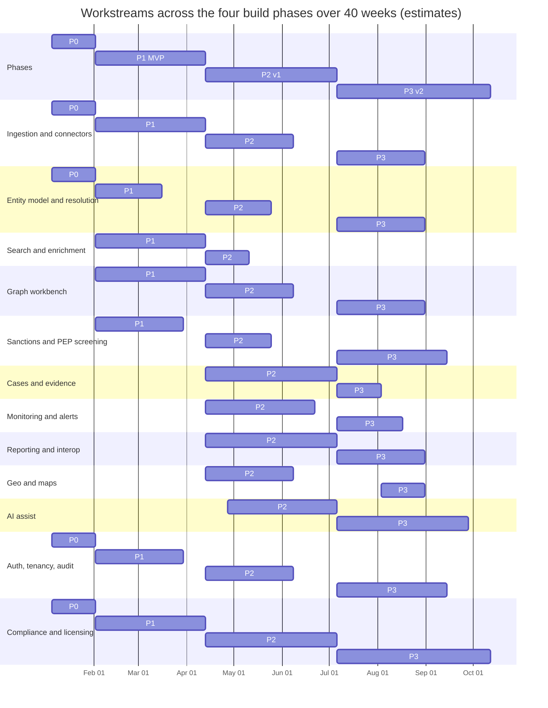
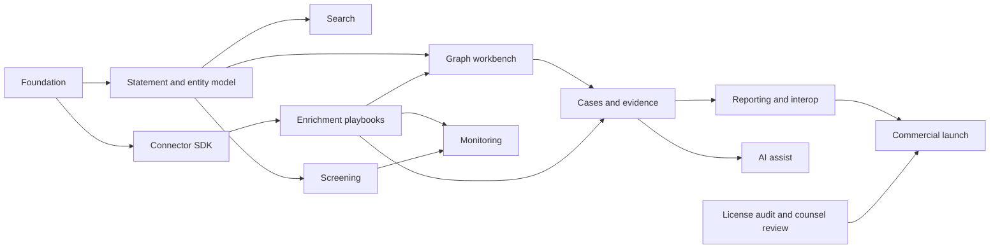

# CoreNews Build Roadmap

Durations, team sizes, and person-weeks are estimates for a focused team; they assume no major scope change.

Every duration, team size, and target is an estimate; license statuses come from the source catalog and are not legal advice. Product requirements, architecture, and licensing live in the [system specification](../spec/SYSTEM_SPEC.md).

## Contents

- [Planning figures](#planning-figures)
- [Schedule](#schedule)
- [Phases](#phases)
- [Dependencies](#dependencies)
- [Risks](#risks)
- [Open decisions and first two weeks](#open-decisions-and-first-two-weeks)

## Planning figures

Requirements by the phase in which they ship:

| Phase | Requirements |
| --- | --- |
| P0 | 8 |
| P1 | 23 |
| P2 | 31 |
| P3 | 9 |

Person-weeks are team size times weeks, rounded.

| Phase | Weeks | Team size | Person-weeks |
| --- | --- | --- | --- |
| P0 Foundation | 4 | 2 | 8 person-weeks |
| P1 MVP: Investigate | 10 | 3.5 | 35 person-weeks |
| P2 v1: Collaborate and monitor | 12 | 4.5 | 54 person-weeks |
| P3 v2: Scale and differentiate | 14 | 5.5 | 77 person-weeks |
| Total | 40 |  | 174 person-weeks |

## Schedule

Gantt chart of workstreams across the four build phases over 40 weeks. Week numbers below are offsets from the start of Phase 0. The chart draws week 0 as 2026-01-05 so the axis has dates; that day is a plotting origin, not a committed start. Bar length is the estimated span. Tasks are labeled with the phase that owns that span (P0, P1 MVP, P2 v1, P3 v2). Gaps are weeks with no segment for that workstream.

Exact segments from the source chart. Each triple is start week, end week, phase. End week is exclusive.

| Workstream | Segments (start week, end week, phase) |
| --- | --- |
| Ingestion and connectors | 0–4 P0; 4–14 P1; 14–22 P2; 26–34 P3 |
| Entity model and resolution | 0–4 P0; 4–10 P1; 14–20 P2; 26–34 P3 |
| Search and enrichment | 4–14 P1; 14–18 P2 |
| Graph workbench | 4–14 P1; 14–22 P2; 26–34 P3 |
| Sanctions and PEP screening | 4–12 P1; 14–20 P2; 26–36 P3 |
| Cases and evidence | 14–26 P2; 26–30 P3 |
| Monitoring and alerts | 14–24 P2; 26–32 P3 |
| Reporting and interop | 14–26 P2; 26–34 P3 |
| Geo and maps | 14–22 P2; 30–34 P3 |
| AI assist | 16–26 P2; 26–38 P3 |
| Auth, tenancy, audit | 0–4 P0; 4–12 P1; 14–22 P2; 26–36 P3 |
| Compliance and licensing | 0–4 P0; 4–14 P1; 14–26 P2; 26–40 P3 |

Phase bars on the same axis: P0 weeks 0–4, P1 MVP weeks 4–14, P2 v1 weeks 14–26, P3 v2 weeks 26–40.

## Phases

| Phase | Window | Duration | Team (estimate) | Goal |
| --- | --- | --- | --- | --- |
| P0 Foundation | Weeks 0 to 4 | 4 weeks | 2 engineers plus John as product owner | Make adding a source and storing a provenance-tracked fact routine. |
| P1 MVP: Investigate | Weeks 4 to 14 | 10 weeks | 3 to 4 engineers plus 0.5 designer | An analyst starts from an indicator or a name, enriches, pivots, screens, and exports in one session. |
| P2 v1: Collaborate and monitor | Weeks 14 to 26 | 12 weeks | 4 to 5 engineers, 0.5 designer, 0.25 legal counsel | Teams run cases with defensible evidence and get alerted when something changes. |
| P3 v2: Scale and differentiate | Weeks 26 to 40 | 14 weeks | 5 to 6 engineers, 1 designer, 0.25 legal counsel | Commercial-ready, interoperable, and differentiated. |

### P0 Foundation (Weeks 0 to 4)

Make adding a source and storing a provenance-tracked fact routine.

Team (estimate): 2 engineers plus John as product owner. Team size used for person-weeks: 2.

**Deliverables**

- Monorepo, CI (lint, tests, gitleaks secret scan, SBOM), Docker Compose dev stack, and ADRs for every decision on the stack table
- Statement store and all 13 entity types in the schema, with six populated: Domain, IP, Organization, Person, Vulnerability, Document
- Connector SDK with manifest, rate limiter, quota counters, cache, retries, and license gate
- Three pilot connectors: NVD, IPinfo Lite, OFAC sanctions list
- Key manager that reads from environment only; auth skeleton with `tenant_id` on every table; OpenTelemetry traces

**Exit criteria**

- A developer who has not seen the code adds a new connector in one day or less
- End-to-end test: fetch, hash raw payload, normalize to statements, query with provenance
- CI fails when a fake secret is planted in a commit; quota-exhaustion test passes
- Stack ADRs approved by John

### P1 MVP: Investigate (Weeks 4 to 14)

An analyst starts from an indicator or a name, enriches, pivots, screens, and exports in one session.

Team (estimate): 3 to 4 engineers plus 0.5 designer. Team size used for person-weeks: 3.5.

**Deliverables**

- All 14 provisioned connectors plus the keyless set, sanctions lists, and the vulnerability pack
- Global search with identifier detection, entity page, and enrichment playbooks for Domain, IP, CVE, and Organization
- Graph canvas with transforms, dry-run quota preview, and confidence display
- Sanctions screening with explainable matches
- RBAC (Admin, Analyst, Viewer), basic audit log, license-flag UI, ethical-use gate, CSV and JSON export

**Exit criteria**

- Five pilot users finish three scripted investigations unaided: a domain, a CVE exposure, a sanctions check
- Every displayed fact shows source, timestamp, and license
- No secrets in git history; connector canary green at least 95 percent of runs over two weeks
- Domain playbook p95 within the NFR target on the pilot dataset

### P2 v1: Collaborate and monitor (Weeks 14 to 26)

Teams run cases with defensible evidence and get alerted when something changes.

Team (estimate): 4 to 5 engineers, 0.5 designer, 0.25 legal counsel. Team size used for person-weeks: 4.5.

**Deliverables**

- Cases, notes, tasks; evidence capture, custody chain, and verify
- Watchlists, change detection, alerts, continuous screening
- PDF reports, STIX 2.1 and MISP export, public API with keys and webhooks
- Multi-tenancy with row-level security, full audit log, admin console, bring-your-own-key
- Map module (FIRMS, USGS, OpenSky, AIS), OpenSearch, entity resolution v1
- AI assist v1: extraction and cited summaries, with an evaluation harness

**Exit criteria**

- Evidence verify passes on 100 percent of captures in test
- Cross-tenant isolation tests pass on every endpoint
- Exported STIX bundles validate with the official STIX validator
- 10 to 20 pilot users active for four weeks; alert noise reviewed with them
- AI citation faithfulness meets a threshold set at phase start (estimate: 95 percent on the golden set)

### P3 v2: Scale and differentiate (Weeks 26 to 40)

Commercial-ready, interoperable, and differentiated.

Team (estimate): 5 to 6 engineers, 1 designer, 0.25 legal counsel. Team size used for person-weeks: 5.5.

**Deliverables**

- TAXII 2.1 server, OpenCTI connector, transform SDK
- Licensed PEP and beneficial-ownership adapter; optional dark-web vendor integration; legal people and social sources through licensed vendors
- Natural-language query, translation, SAML SSO and SCIM, retention and legal hold
- Commercial licensing remediation for every flagged source; plans and billing
- Graph database decision against measured thresholds, load tests, disaster-recovery drill, SOC 2 readiness work

**Exit criteria**

- Every connector enabled in commercial mode has a documented, counsel-approved license status
- Load test passes at twice the scale target; disaster-recovery drill meets RPO and RTO
- Three design-partner customers running in production

## Dependencies

Commercial launch is a terminal. It depends on reporting and interop, and on the license audit and counsel review.

## Risks

Likelihood and impact are judgments, not measurements.

| Risk | Likelihood | Impact | Mitigation |
| --- | --- | --- | --- |
| Free-tier licenses block monetization | High | High | License gate from P0; counsel review in P2; budget for paid tiers or replacements |
| Source APIs change or shut down (several already have) | High | Medium | Contract tests, weekly canary, two sources per capability where possible |
| Quota exhaustion on small free tiers | High | Medium | Budgets, dry-run cost preview, cache, interactive-first scheduling |
| Scope creep beyond team capacity | High | High | Phase gates with exit criteria; keep a cut list (P3 items first) |
| Wrong entity merges corrupt investigations | Medium | High | Non-destructive `same_as`; human confirmation for people and organizations |
| Privacy or legal exposure from person data | Medium | High | PII flags, retention, ethical-use gate, counsel review |
| AI states unsupported facts | Medium | High | Citation enforcement, evaluation harness in CI, tenant opt-in |
| Capture sandbox abused for SSRF | Medium | High | Isolated network, egress filtering, resource limits, security review |
| Graph outgrows Postgres | Medium | Medium | `GraphStore` interface; measured thresholds trigger a graph database evaluation |
| Evidence assumed legally admissible | Medium | Medium | Document procedures, state limits plainly, advise counsel review |
| Secret leakage | Low | High | gitleaks, redaction, secret manager, rotation runbook |

## Open decisions and first two weeks

1. Commercial intent and timing: internal research only, or a paid product? This sets when license remediation starts.
2. Team: who builds, and is AI-assisted solo development the plan? It changes the calendar by about two times.
3. Hosting: self-hosted on your own infrastructure, or a managed cloud?
4. Tenancy: single-tenant deployments per customer, or multi-tenant SaaS? The schema supports both; operations differ.
5. AI stance: which providers are acceptable for case data, and is a self-hosted model required?
6. Lead persona: confirm small CTI and due-diligence teams first.

### First two weeks

1. **Days 1 to 2.** Repository, CI with secret scanning, Compose stack, and the ADR template; confirm the stack table.
2. **Days 3 to 5.** Statement store, entity schema, and canonical-key normalizers with tests.
3. **Week 2.** Connector SDK with limiter, cache, and license gate; first connector (NVD) end to end with raw hashing.
4. **End of week 2.** IPinfo Lite and OFAC connectors; key manager reads from environment; demo query showing provenance on every fact.

## Related documents

- [System specification](../spec/SYSTEM_SPEC.md)
- CoreNews OSINT Source Catalog
- CoreNews Competitive Gap Analysis

External canvas links are omitted from this copy.
