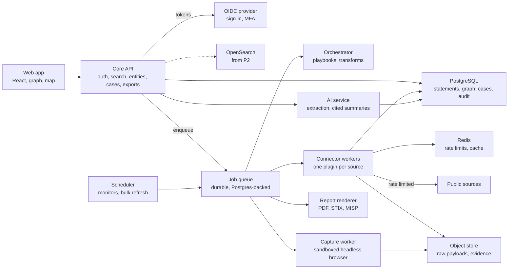
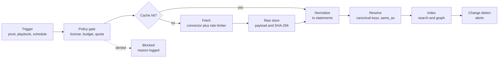
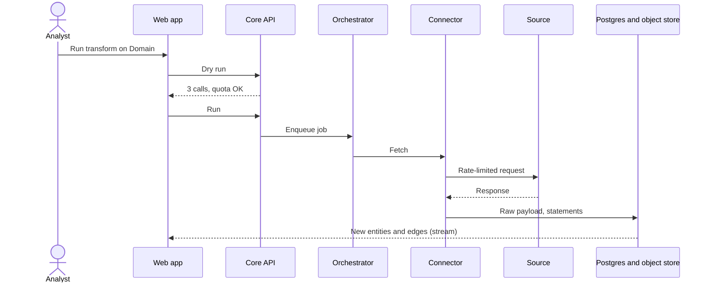
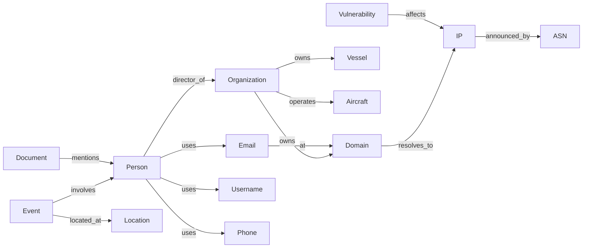

# CoreNews System Specification

A full product and system specification for CoreNews, the free-source OSINT platform, and a four-phase plan to build it in about 40 weeks. Every duration, team size, and target is an estimate; license statuses come from the source catalog and are not legal advice.

The phased roadmap, risks, open decisions, and first-two-weeks plan are in [ROADMAP.md](../roadmap/ROADMAP.md).

## Contents

- [Scope and assumptions](#scope-and-assumptions)
- [Vision and personas](#vision-and-personas)
- [Recommended stack and key decisions](#recommended-stack-and-key-decisions)
- [Functional requirements](#functional-requirements)
- [Architecture](#architecture)
- [Connector framework and source inventory](#connector-framework-and-source-inventory)
- [Data model](#data-model)
- [Workbench, screening, evidence, and AI design](#workbench-screening-evidence-and-ai-design)
- [API outline](#api-outline)
- [Security, tenancy, and privacy](#security-tenancy-and-privacy)
- [Legal, ethics, and licensing](#legal-ethics-and-licensing)
- [Non-functional requirements](#non-functional-requirements)
- [Testing and observability](#testing-and-observability)
- [Related documents](#related-documents)

## Scope and assumptions

> **Greenfield assumption.** I checked /workspace/CoreNews and found only .env, .env.example, .gitignore, and setkey.sh. There is no application code, no git repository, and no UI. This spec therefore treats CoreNews as a new build. If an app exists elsewhere, Phase 0 becomes a gap-fit review against this spec instead of a start from scratch.

| Figure | Value | Detail |
| --- | --- | --- |
| Estimated build to v2 | 40 weeks | four phases |
| Estimated person-weeks | 174 | team size times weeks |
| Functional requirements | 71 | 12 modules |
| Sources already keyed | 14 | in the local .env |

Person-weeks are team size times weeks, rounded: P0 4 × 2 = 8, P1 10 × 3.5 = 35, P2 12 × 4.5 = 54, P3 14 × 5.5 = 77.

- Inputs: the OSINT Source Catalog (76 sources), the Competitive Gap Analysis, and the variable names in .env.example. No key value was read or is shown here.
- Solo or AI-assisted build: expect roughly two to two and a half times the calendar duration for the same scope (estimate).
- Out of scope by design: scraping that violates a site's terms, ingesting leaked credential dumps, identifying households or individuals from IP geolocation, sock-puppet accounts, an in-house dark-web crawler, and a real-time social firehose.
- No vendor pricing is quoted. Where a license or limit could not be confirmed it is marked unverified.

## Vision and personas

CoreNews is a provenance-first, license-aware OSINT workbench that unifies public cyber, civic, geospatial, and news data, and exports into OpenCTI and MISP rather than competing with them. Every fact cites its source, collection time, and license.

| Persona | Job to be done | Must-have capabilities | Success signal (target) |
| --- | --- | --- | --- |
| Intelligence analyst | Resolve who or what is behind an indicator or name and map connections | Graph pivots, entity resolution, confidence, saved investigations | Time from indicator to first useful graph under 5 minutes |
| Journalist / researcher | Verify claims, trace ownership, and document findings for publication | Corporate and political-finance sources, evidence capture, cited reports | Every published claim traceable to a hashed capture |
| Due diligence / compliance | Screen people and organizations and keep an auditable record | Official sanctions lists, explainable matching, disposition workflow, audit log | Screening decisions reproducible months later |
| SOC / CTI analyst | Triage indicators and track exposure and vulnerabilities | Reputation enrichment, KEV and EPSS, watchlists, alerts, STIX and MISP export | Alerts that need no manual re-enrichment |

Recommended lead persona: small CTI and due-diligence teams, because the keys already provisioned are cyber-heavy and official sanctions and corporate sources are commercially clean. Journalists and NGOs follow in v1 through case and evidence features.

## Recommended stack and key decisions

Each row is an architecture decision record to confirm in Phase 0. Choices favor a small team and few moving parts.

| Area | Recommendation | Why |
| --- | --- | --- |
| Shape | Modular monolith API plus separate worker processes | One deployable to reason about; split into services only when a measured need appears |
| Backend | Python 3.12, FastAPI, SQLAlchemy and Alembic, pydantic | Best ecosystem for OSINT clients, NLP, and data matching; typed contracts |
| Frontend | TypeScript, React with Next.js, Cytoscape.js for the graph (evaluate WebGL sigma.js past 5,000 nodes), MapLibre GL for maps | Mature open-source graph and map libraries; no per-seat licensing |
| System of record | PostgreSQL 16 with PostGIS, pg_trgm, and pgvector | One store for statements, relationships, cases, and geo; fewer systems to run |
| Graph | Relationships table with recursive queries behind a `GraphStore` interface | Avoids a second database early; swap to Neo4j, Memgraph, or Apache AGE if thresholds in the NFR table are missed |
| Search | Postgres trigram in P1, OpenSearch in P2 | Ship search fast, add faceting and scale when data volume demands it |
| Queue and cache | Redis for rate limits and cache; Postgres-backed durable job queue | Quota counters need atomic shared state; durable jobs without another broker. Add Temporal only if long human-in-the-loop workflows appear |
| Object store | S3-compatible with object lock (MinIO in dev) | Write-once storage for raw payloads and evidence |
| Entity schema | Borrow statement and schema ideas from FollowTheMoney (open source; confirm license in the ADR), extend with cyber types | Proven provenance-friendly model for people, organizations, vessels, and documents |
| Identity | OIDC provider (Keycloak self-hosted, or a managed provider) | Standard SSO path; SAML and SCIM later |
| Delivery | Containers, Docker Compose for dev, Terraform and a managed container platform or Kubernetes for prod, GitHub Actions | Reproducible environments; secret scanning in CI |
| Observability | OpenTelemetry, Prometheus and Grafana, Sentry | Per-connector metrics are a product requirement |
| Standards | STIX 2.1, TAXII 2.1, MISP format, Admiralty code, RFC 3161, WARC, OpenAPI 3.1 | Interoperability is part of the positioning |

## Functional requirements

Phase is when the requirement ships: P0 foundation, P1 MVP, P2 v1, P3 v2.

71 requirements across 12 modules. Showing 71 of 71 requirements.

| Phase | Requirements |
| --- | --- |
| P0 | 8 |
| P1 | 23 |
| P2 | 31 |
| P3 | 9 |

### Ingestion

| ID | Module | Requirement | Phase |
| --- | --- | --- | --- |
| ING-1 | Ingestion | Every source is a plugin with a manifest (id, auth type, base URL, endpoints, entity types in and out, rate limit, quota, cache TTL, license flags, attribution text) and `fetch`, `normalize`, `healthcheck` functions. | P0 |
| ING-2 | Ingestion | Per-connector token-bucket rate limiter plus daily and monthly quota counters in Redis, shared by all workers. Over-limit calls queue or fail fast with `quota_exhausted`. | P0 |
| ING-3 | Ingestion | Response cache keyed by connector, endpoint, and normalized params, with per-connector TTL. Every raw payload is stored in the object store with a SHA-256 hash. | P0 |
| ING-4 | Ingestion | Retries with exponential backoff and jitter, per-connector circuit breaker, and a dead-letter queue visible to admins. | P0 |
| ING-5 | Ingestion | License gate: each connector declares `commercial_use` (allowed, attribution, noncommercial, unknown). The tenant's deployment mode (internal research or commercial) decides which connectors may run. | P0 |
| ING-6 | Ingestion | Bulk ingestors for lists and datasets (sanctions lists, CISA KEV, EPSS, CVE List, GeoLite2 database, Tor lists) on schedules, with diffing and versioned snapshots. | P1 |
| ING-7 | Ingestion | Key manager: keys come only from environment or a secret manager. The UI shows present or absent, last used, and quota burn, and never displays a value. | P1 |
| ING-8 | Ingestion | Contract tests with recorded fixtures for each connector, plus a scheduled live canary that flags API drift or shutdowns. | P1 |
| ING-9 | Ingestion | Tenant bring-your-own-key: per-tenant keys, encrypted with envelope encryption, override shared keys. | P2 |
| ING-10 | Ingestion | Streaming and polling connectors (AISStream, OpenSky) with bounded retention and back-pressure. | P2 |

### Entity model

| ID | Module | Requirement | Phase |
| --- | --- | --- | --- |
| ENT-1 | Entity model | Statement-based model: every fact is (entity, property, value, source, retrieved_at, confidence, license, raw_ref). An entity is a view over its statements. | P0 |
| ENT-2 | Entity model | Core entity types: Person, Organization, Domain, IP, Email, Phone, Username, Vessel, Aircraft, Location, Document, Event, Vulnerability. Adds Certificate, ASN, URL, FileHash, Wallet in P1. | P0 |
| ENT-3 | Entity model | Deterministic normalization and canonical keys: punycode and lowercase domains, canonical IPs, E.164 phones, normalized emails, ICAO24, IMO, MMSI, LEI, CIK, CVE ID. | P0 |
| ENT-4 | Entity model | Typed relationships with their own provenance: resolves_to, owns, registered_by, hosted_on, director_of, subsidiary_of, sanctioned_by, mentions, located_at, uses, exploits, same_as. | P1 |
| ENT-5 | Entity model | Confidence from Admiralty-style source reliability (A to F) and information credibility (1 to 6), mapped to a 0 to 1 score and shown on every fact. | P1 |
| ENT-6 | Entity model | Entity resolution through non-destructive `same_as` assertions with scores. Auto-merge only on strong deterministic keys; Person and Organization merges are human-confirmed. | P2 |
| ENT-7 | Entity model | Versioned entity schemas with migrations, and custom properties per tenant. | P2 |

### Search

| ID | Module | Requirement | Phase |
| --- | --- | --- | --- |
| SRC-1 | Search | Global search box with type-ahead and automatic identifier detection (IP, domain, CVE, email, hash, LEI, phone). | P1 |
| SRC-2 | Search | Full-text and fuzzy name search with facets by type, source, date, and confidence. Postgres trigram first, OpenSearch in P2. | P1 |
| SRC-3 | Search | Saved searches and per-user search history. | P1 |
| SRC-4 | Search | Typed query DSL that is also the target for natural-language queries. | P2 |

### Workbench

| ID | Module | Requirement | Phase |
| --- | --- | --- | --- |
| GRF-1 | Workbench | Entity page: attributes grouped by source with provenance, a timeline, and related entities. | P1 |
| GRF-2 | Workbench | Graph canvas: expand neighbors, filter by edge type, confidence, and source, pin, group, undo. Render cap of about 5,000 nodes. | P1 |
| GRF-3 | Workbench | Transforms and pivots: run a registered transform on a selected entity, with a dry-run preview of quota cost before any external call. | P1 |
| GRF-4 | Workbench | Force, hierarchical, and timeline layouts, and path-finding between two entities with a depth limit. | P2 |
| GRF-5 | Workbench | Save a graph as a case artifact and export GEXF, GraphML, JSON, and a STIX bundle. | P2 |
| GRF-6 | Workbench | Transform SDK so teams can add sandboxed custom transforms. | P3 |

### Enrichment

| ID | Module | Requirement | Phase |
| --- | --- | --- | --- |
| ENR-1 | Enrichment | Declarative playbooks (YAML DAGs) per entity type, for example Domain: RDAP, DNS, certificate transparency, DNSDumpster, Shodan and Censys, reputation sources, IPinfo and GeoLite2. | P1 |
| ENR-2 | Enrichment | Per-entity-type auto-enrichment policy with a call budget so one search cannot burn a daily quota. | P1 |
| ENR-3 | Enrichment | Quota-aware scheduler that ranks interactive requests above background jobs. | P1 |
| ENR-4 | Enrichment | Vulnerability pack: CVE to NVD, CISA KEV, EPSS, OSV, ATT&CK mapping, and a join to exposed hosts from Shodan and Censys. | P1 |
| ENR-5 | Enrichment | Re-run diffing: a repeated enrichment reports what changed since the last run. | P2 |

### Monitoring

| ID | Module | Requirement | Phase |
| --- | --- | --- | --- |
| MON-1 | Monitoring | Watchlists of entities, identifiers, and keywords. | P2 |
| MON-2 | Monitoring | Scheduled re-checks per watch using the quota-aware scheduler. | P2 |
| MON-3 | Monitoring | Change detection that emits alerts: new subdomain, new certificate, new sanctions match, KEV addition, fire detection in an area of interest, aircraft or vessel entering a geofence. | P2 |
| MON-4 | Monitoring | Alert channels: in-app, email, webhook, Slack, with dedupe, throttling, and digests. | P2 |
| MON-5 | Monitoring | Alert triage states and a feedback loop that tunes noisy watches. | P3 |

### Cases and evidence

| ID | Module | Requirement | Phase |
| --- | --- | --- | --- |
| CAS-1 | Cases & evidence | Raw API payloads are kept with hashes and linkable from any fact (the base of evidence handling). | P1 |
| CAS-2 | Cases & evidence | Cases with members, status, tags, linked entities and graphs, markdown notes, and tasks. | P2 |
| CAS-3 | Cases & evidence | Web evidence capture through a sandboxed headless browser: full-page screenshot, PDF, HTML or WARC, and metadata, each with a SHA-256 hash and an optional RFC 3161 trusted timestamp. | P2 |
| CAS-4 | Cases & evidence | Chain of custody: append-only, hash-chained event log of who captured, viewed, and exported; evidence in a write-once bucket; a verify action that re-hashes. | P2 |
| CAS-5 | Cases & evidence | Notes and report claims link to evidence or statement IDs, and the report builder flags uncited claims. | P2 |
| CAS-6 | Cases & evidence | Retention and legal-hold policies per case, compatible with data-subject erasure rules. | P3 |

### Reporting

| ID | Module | Requirement | Phase |
| --- | --- | --- | --- |
| RPT-1 | Reporting | CSV and JSON export for any table or result set, with source and license columns. | P1 |
| RPT-2 | Reporting | PDF report from case templates with citations, an evidence hash appendix, and attribution and license footers. | P2 |
| RPT-3 | Reporting | STIX 2.1 bundle export (observables, indicators, infrastructure, vulnerabilities, identities, relationships) with provenance in external references. | P2 |
| RPT-4 | Reporting | MISP event export, with optional push to a configured MISP instance. | P2 |
| RPT-5 | Reporting | TAXII 2.1 server collections and an OpenCTI connector. | P3 |

### Screening

| ID | Module | Requirement | Phase |
| --- | --- | --- | --- |
| SCR-1 | Screening | Ingest OFAC, EU consolidated, UN Security Council consolidated, and UK sanctions lists as versioned snapshots. | P1 |
| SCR-2 | Screening | Name matching with normalization, transliteration, token and phonetic comparison, date-of-birth and country boosters, thresholds, and explainable match reasons. | P1 |
| SCR-3 | Screening | Batch screening from CSV upload and per-entity screening, with results stored as evidence. | P2 |
| SCR-4 | Screening | Continuous screening: a list update re-screens watched entities and raises alerts. | P2 |
| SCR-5 | Screening | Disposition workflow (true or false positive, reason, reviewer) with audit trail. | P2 |
| SCR-6 | Screening | PEP and beneficial-ownership screening through a licensed provider adapter. Free signals (Wikidata, LittleSis, ICIJ) are labeled unverified and are not a compliance-grade PEP check. | P3 |

### Geo

| ID | Module | Requirement | Phase |
| --- | --- | --- | --- |
| GEO-1 | Geo | MapLibre map with layers: NASA FIRMS fires, USGS earthquakes, OpenSky aircraft, AIS vessels, and approximate IP location with a precision disclaimer. | P2 |
| GEO-2 | Geo | Areas of interest, time slider, entity-to-location links, and GeoJSON export. | P2 |
| GEO-3 | Geo | Satellite imagery browsing from Copernicus. | P3 |

### AI assist

| ID | Module | Requirement | Phase |
| --- | --- | --- | --- |
| AI-1 | AI assist | Entity extraction from pasted text and documents into candidate entities that a human accepts or rejects. | P2 |
| AI-2 | AI assist | Cited summaries of an entity or case. Each sentence links to statement or evidence IDs; sentences without a citation are dropped. | P2 |
| AI-3 | AI assist | Provider abstraction. A tenant can disable AI or choose a self-hosted model, and no case data goes to a third-party model without tenant opt-in. Prompts and outputs are logged. | P2 |
| AI-4 | AI assist | Evaluation harness with a golden set for extraction accuracy and citation faithfulness, run in CI. | P2 |
| AI-5 | AI assist | Natural-language to query DSL, previewed to the user before it runs and executed under the user's own permissions. | P3 |
| AI-6 | AI assist | Translation of foreign-language documents with the original kept beside it. | P3 |

### Platform

| ID | Module | Requirement | Phase |
| --- | --- | --- | --- |
| PLT-1 | Platform | OIDC sign-in with required MFA for admins (an auth skeleton lands in P0). | P1 |
| PLT-2 | Platform | Roles: Admin, Lead, Analyst, Viewer, Auditor, and API service. Case-level ACLs arrive with cases in P2. | P1 |
| PLT-3 | Platform | Ethical-use gate: first-run policy acceptance and a blocked-use list (no household identification from IP data, no credential dumps). | P1 |
| PLT-4 | Platform | Audit log of searches, enrichments, exports, and admin changes: who, what, when, which source. | P1 |
| PLT-5 | Platform | Multi-tenancy with `tenant_id` on every row, Postgres row-level security, and per-tenant object prefixes. | P2 |
| PLT-6 | Platform | Public REST API with API keys, webhooks, and a published OpenAPI document. | P2 |
| PLT-7 | Platform | Admin console for users, connectors, quotas, license mode, and retention. | P2 |
| PLT-8 | Platform | SAML SSO and SCIM provisioning. | P3 |

## Architecture

OpenSearch is reached by a dashed edge because it arrives in P2. Public sources, and in the pipeline below the trigger and the blocked outcome, are terminals.

| Component | Responsibility | Phase |
| --- | --- | --- |
| Core API | Auth, RBAC, search, entities, cases, exports, audit; the only component browsers talk to | P0 |
| Connector workers | Run connector plugins under limiter, cache, and license gate; write raw payloads and statements | P0 |
| Orchestrator | Execute enrichment playbooks and transforms as DAGs with budgets | P1 |
| Scheduler | Watch re-checks and bulk dataset refresh | P1 bulk, P2 watches |
| Capture worker | Evidence capture in an isolated network with egress filtering | P2 |
| AI service | Extraction and cited summaries behind a provider abstraction | P2 |
| Report renderer | PDF, STIX 2.1, and MISP builders | P2 |

### Ingestion pipeline

The denied edge is dashed. Trigger and Blocked are terminals. Cache hit is a decision.

### Pivot flow

Dashed arrows are replies.

## Connector framework and source inventory

Keys already provisioned map to connectors as below. Variable names only; values stay in the local .env and later a secret manager. GreyNoise has an account but no key. ABUSECH_AUTH_KEY and COMPANIES_HOUSE_API_KEY are empty by choice.

| Variable | Source | Role in CoreNews | License status | Phase |
| --- | --- | --- | --- | --- |
| SHODAN_API_KEY | Shodan | Host and service exposure for IPs and domains | Unverified: check terms before monetizing | P1 |
| CENSYS_API_TOKEN | Censys | Hosts, certificates, internet inventory | Unverified: check terms before monetizing | P1 |
| VIRUSTOTAL_API_KEY | VirusTotal | Reputation and relations for domain, IP, URL, hash | Unverified: free tiers are commonly non-commercial | P1 |
| OTX_API_KEY | AlienVault OTX | Pulses and indicators of compromise | Unverified: check terms before monetizing | P1 |
| ABUSEIPDB_API_KEY | AbuseIPDB | IP abuse reports and confidence score | Unverified: check terms before monetizing | P1 |
| URLSCAN_API_KEY | urlscan.io | URL scans, screenshots, contacted hosts | Unverified: check terms before monetizing | P1 |
| HUNTER_API_KEY | Hunter | Domain to email addresses (personal data) | Unverified; personal data needs a lawful basis | P1 |
| NVD_API_KEY | NIST NVD | CVE records and CVSS | Clear per catalog | P1 |
| DATA_GOV_API_KEY | OpenFEC and Congress.gov | Political finance and legislation | Clear per catalog | P1 |
| IPINFO_TOKEN | IPinfo Lite | IP to ASN and country | Clear with attribution | P1 |
| DNSDUMPSTER_API_KEY | DNSDumpster | Subdomains and DNS records | Catalog says check terms | P1 |
| MAXMIND_ACCOUNT_ID, MAXMIND_LICENSE_KEY | MaxMind GeoLite2 | Local IP geolocation and ASN database | Clear with attribution; must not identify a household or person | P1 |
| NASA_FIRMS_MAP_KEY | NASA FIRMS | Active fire detections | Clear with attribution | P2 |
| OPENSKY_CLIENT_ID, OPENSKY_CLIENT_SECRET | OpenSky Network | Aircraft state vectors | Catalog says check terms | P2 |

Keyless sources to add early, because they carry no signup and several are commercially clean:

- OFAC, EU, UN, and UK sanctions lists (clear per catalog for OFAC and UK; EU and UN are check terms)
- CISA KEV, EPSS, OSV, CVE List, MITRE ATT&CK (clear per catalog)
- GLEIF LEI and SEC EDGAR (clear per catalog)
- Wikidata (CC0)
- USGS earthquakes (public domain per catalog)
- Certificate transparency, RDAP, RIPEstat, Team Cymru IP-ASN (named in the gap analysis; confirm terms in P0)

### Connector manifest fields

| Field | Purpose |
| --- | --- |
| `id`, `version` | Stable identifier and manifest version |
| `auth` | none, api_key, oauth_client_credentials; names the environment variable, never the value |
| `entity_in`, `entity_out` | Entity types the connector accepts and produces; drives transform menus |
| `rate_limit` | Requests per second and burst, enforced by a shared token bucket |
| `quota` | Daily and monthly caps and the reset rule; verified against official docs or marked unverified |
| `cache_ttl` | Seconds to serve a cached response |
| `license` | `commercial_use`, attribution text, redistribution limits, source terms URL, last reviewed date |
| `reliability` | Admiralty source grade used in confidence scoring |
| `pii` | Whether results contain personal data, which triggers retention and lawful-basis checks |

## Data model

### Statement (the unit of fact)

| Field | Meaning |
| --- | --- |
| entity_id | The entity the fact is about |
| property | Typed property name, for example `domain.registrar` |
| value | Normalized value plus the original string |
| source_id, raw_ref | Connector and the hashed raw payload it came from |
| retrieved_at, valid_from, valid_to | When collected and when the fact held |
| confidence | 0 to 1, derived from Admiralty reliability and credibility |
| license | Commercial-use flag and attribution carried from the connector |
| tenant_id | Row-level security key |

### Core tables

| Table | Key columns | Notes |
| --- | --- | --- |
| `entities` | id, tenant_id, type, canonical_key | Unique on tenant, type, canonical key |
| `statements` | entity_id, property, value, source_id, raw_ref, retrieved_at, confidence, license | Append-only; supersession by newer retrieval |
| `relationships` | from_id, to_id, type, source_id, confidence, valid_from, valid_to | Includes `same_as` with a score |
| `raw_objects` | sha256, uri, source_id, retrieved_at, size | Content-addressed; object lock |
| `sources`, `connector_runs` | manifest, enabled, quota state, status, latency | Feeds the key and quota dashboard |
| `list_entries`, `screening_matches` | list, version, names, dob, country; score, reasons, disposition | Versioned sanctions snapshots |
| `cases`, `case_items` | status, members, linked entities, notes | Case-level ACL |
| `evidence_items`, `custody_events` | artifact hash, tool versions; actor, action, prev_hash, hash | Hash chain for tamper evidence |
| `watches`, `alerts` | target, interval, channels; trigger, state | Driven by the scheduler |
| `audit_log` | actor, action, target, source, at | Append-only, exportable |
| `tenants`, `users`, `api_keys` | roles, license mode, hashed API keys | No raw key stored |

## Workbench, screening, evidence, and AI design

### Transforms and pivots

| Input | Transform | Sources | Output |
| --- | --- | --- | --- |
| Domain | DNS and subdomains | DNSDumpster, certificate transparency, RDAP | Domain, IP, Certificate |
| Domain | Hosting and exposure | Shodan, Censys, IPinfo, GeoLite2 | IP, ASN, Vulnerability |
| Domain, IP, URL | Reputation | VirusTotal, OTX, AbuseIPDB, urlscan | Document, Event |
| Domain | Email discovery (personal data) | Hunter | Email, Person |
| IP | Network and approximate location | IPinfo Lite, GeoLite2, Team Cymru | ASN, Location (approximate) |
| CVE | Exploitability | NVD, CISA KEV, EPSS, OSV, ATT&CK | Vulnerability, Event |
| Person, Organization | Sanctions screen | OFAC, EU, UN, UK lists | Match records |
| Organization | Corporate records | GLEIF, SEC EDGAR (Companies House when keyed) | Organization, Person |
| Person, Organization | Political finance | OpenFEC, Congress.gov | Person, Organization, Document |
| Aircraft | Track | OpenSky | Location, Event |
| Location | Hotspots | NASA FIRMS, USGS | Event |

### Sanctions and PEP screening

- Use only official lists (OFAC, EU, UN, UK) as the shippable core; keep each list version so a past screening can be reproduced.
- Match on normalized names with transliteration, token-set and phonetic comparison, boosted by date of birth and country, and show the reasons behind each score.
- Thresholds are configurable per tenant; every disposition records reviewer, reason, and time.
- Free PEP signals are labeled unverified. A compliance-grade PEP and beneficial-ownership check needs a licensed provider (P3).

### Evidence capture and chain of custody

1. **Request.** An analyst captures a URL, or an enrichment stores a raw API payload automatically.
2. **Isolated fetch.** A sandboxed headless browser runs in its own network behind an egress proxy that blocks private address ranges (SSRF protection), with no stored cookies.
3. **Hash and store.** Screenshot, PDF, HTML or WARC, and metadata each get a SHA-256 hash and go to a write-once bucket with tool versions and capture time.
4. **Timestamp.** Optional RFC 3161 trusted timestamp token per artifact.
5. **Custody log.** Each capture, view, and export appends an event carrying the previous event's hash.
6. **Verify.** A verify action re-hashes artifacts and the log; exports include a manifest of hashes.

CoreNews supports defensible handling. It does not itself guarantee legal admissibility; confirm procedures with counsel before relying on evidence in proceedings.

### AI assist guardrails

- Retrieval over statements and evidence only; the model cannot assert a fact without an ID the UI can open.
- Output is checked: sentences without valid citations are removed, and the user sees what was dropped.
- Natural-language queries become a typed DSL shown to the user first, then run with that user's permissions.
- Tenant controls: AI off, self-hosted model, or approved provider; case data never leaves without opt-in; all prompts and outputs are logged.
- A golden-set evaluation runs in CI and blocks releases that regress extraction accuracy or citation faithfulness.

## API outline

REST with OpenAPI 3.1, cursor pagination, idempotency keys on writes, problem+json errors, tenant taken from the token. Paths are a sketch for P0 design review.

| Endpoint | Purpose | Phase |
| --- | --- | --- |
| `GET /v1/search` | Search entities with `q`, `types`, filters | P1 |
| `GET /v1/entities/{id}`, `/statements`, `/neighbors` | Entity, its provenance, and graph expansion with depth and edge filters | P1 |
| `POST /v1/transforms/{id}/run` | Run a transform; `dry_run` returns cost and quota check | P1 |
| `POST /v1/playbooks/{id}/run`, `GET /v1/jobs/{id}` | Run a playbook and follow its job, with server-sent events | P1 |
| `POST /v1/screenings`, `GET /v1/screenings/{id}` | Screen names or entities; explainable results | P1 |
| `GET /v1/connectors`, `PATCH /v1/connectors/{id}`, `GET /v1/quotas` | Enable connectors, set budgets, read quota burn | P1 |
| `/v1/cases`, `/v1/cases/{id}/evidence`, `/custody`, `POST /v1/evidence/{id}/verify` | Cases, captures, custody log, integrity check | P2 |
| `/v1/watches`, `GET /v1/alerts`, webhooks | Monitoring and alert delivery | P2 |
| `POST /v1/exports` | Export as csv, json, stix21, misp, or pdf for a scope | P1 csv and json, P2 rest |
| `POST /v1/ai/extract`, `/ai/summaries`, `/ai/query` | Extraction, cited summaries, natural-language query | P2, query P3 |
| `GET /v1/audit` | Audit log search and export | P1 |

## Security, tenancy, and privacy

| Area | Requirement | Approach |
| --- | --- | --- |
| Secrets | Keys never in git, chat, tickets, or the browser | Local .env gitignored with 0600 permissions; .env.example holds names only; gitleaks in pre-commit and CI; secret manager in production; rotation runbook; log redaction; connectors run server-side only |
| Authentication | Strong sign-in | OIDC, MFA required for admins, short-lived tokens, hashed API keys |
| Authorization | Least privilege | Roles plus case-level ACLs; auditors read-only |
| Tenancy | No cross-tenant reads | `tenant_id` on every row, Postgres row-level security, per-tenant object prefixes, an automated isolation test over every endpoint |
| Encryption | Protect data in transit and at rest | TLS everywhere; encrypted volumes and buckets; envelope encryption for tenant keys |
| Audit | Know who looked at what | Append-only audit of searches, enrichments, exports, and admin changes |
| Capture safety | No SSRF or sandbox escape | Isolated network, egress proxy blocking private ranges, resource limits, no credentials in the browser profile |
| Supply chain | Trusted dependencies | Dependency scanning, SBOM, pinned images |
| Privacy | Personal data handled lawfully | PII flag per connector, minimization, retention limits, access and deletion workflow, regional hosting option |
| Abuse | Ethical use enforced | Policy acceptance, blocked-use list, query rate limits, audit review |

## Legal, ethics, and licensing

From the source catalog as of 18 November 2026 (America/Detroit). Not legal advice; re-read current terms before shipping a feature on a source.

> **License mode is a product switch.** Build the license gate in Phase 0. John can run in internal-research mode now, while commercial mode enables only connectors whose license is cleared. Several free tiers cannot back a paid product, so this is a launch blocker, not a footnote.

| Group | Sources | Action before monetizing |
| --- | --- | --- |
| Clear | NVD, CISA KEV, EPSS, OSV, CVE List, GLEIF, SEC EDGAR, OpenFEC, Congress.gov, OFAC, UK Sanctions, Wikidata, USGS | Keep an inventory; honor attribution where required |
| Clear with attribution or share-alike | IPinfo Lite, MaxMind GeoLite2, NASA FIRMS, OSM data (ODbL), Overture (mixed themes) | Show attribution in UI and exports; do not identify a household or person from GeoLite; mind ODbL share-alike |
| Paid or commercial path needed | OpenSanctions bulk (non-commercial), abuse.ch, OpenCorporates, Google Safe Browsing, NewsAPI developer tier, Open-Meteo free, Netlas Community, Pulsedive free, OpenPhish Community | Do not ship in commercial mode; buy a license or replace |
| Unverified | Shodan, Censys, VirusTotal, OTX, AbuseIPDB, urlscan, Hunter, DNSDumpster, OpenSky, plus catalog rows marked check terms | Read each current terms page and record the result in the connector manifest; get counsel review |

- Person, email, phone, and social data is personal data under GDPR and CCPA: define lawful basis, minimization, retention, and deletion handling before enabling those connectors.
- Publish an ethical-use policy: no terms-violating scraping, no stolen credential dumps, no deanonymizing ordinary people, no sock-puppet abuse. It doubles as a sales asset.
- Redistribution rules (ACLED, Media Cloud, Aleph, ICIJ) must be checked before showing or exporting their records to third parties.

## Non-functional requirements

All figures are planning targets and estimates, to be validated in Phase 0 and by load tests in Phase 3.

| Area | Target |
| --- | --- |
| Availability | 99.5 percent monthly at v1, 99.9 percent by v2 |
| Search latency | p95 under 300 ms at 50 million statements |
| Entity page | p95 under 800 ms from cache, under 2 s cold |
| Graph expand | p95 under 1.5 s for 500 neighbors at depth 1; revisit graph database if depth 2 exceeds this or edges pass about 50 million |
| Domain playbook | p95 under 30 s for a first pass, limited by external sources |
| Alert latency | Within the watch interval plus 5 minutes |
| Scale at v1 | 10 tenants, 100 users, 100 million statements, 1 TB raw objects within 12 months |
| Recovery | RPO 15 minutes, RTO 4 hours |
| Quota safety | No connector exceeds its configured daily budget; alert at 80 percent |

## Testing and observability

- Unit tests for normalization and matching; contract tests per connector from recorded fixtures; a weekly live canary against each source.
- End-to-end tests for the three pilot investigations; tenant-isolation tests on every endpoint; evidence hash and custody-chain verification tests.
- Matching quality: a labeled sanctions test set with tracked precision and recall, and a golden set for AI extraction and citation faithfulness.
- Load tests before P3 exit; chaos tests that kill workers and sources mid-job.
- Per-connector dashboards: latency, error rate, quota burn, cache hit rate, license mode; alerts on drift, circuit-breaker opens, and canary failures.
- Distributed tracing from click to external call; structured logs with secret redaction.

## Related documents

- [Build roadmap, risks, open decisions, and the first two weeks](../roadmap/ROADMAP.md)
- CoreNews OSINT Source Catalog
- CoreNews Competitive Gap Analysis

The catalog and the gap analysis are the inputs named under [Scope and assumptions](#scope-and-assumptions). External canvas links are omitted from this copy.
